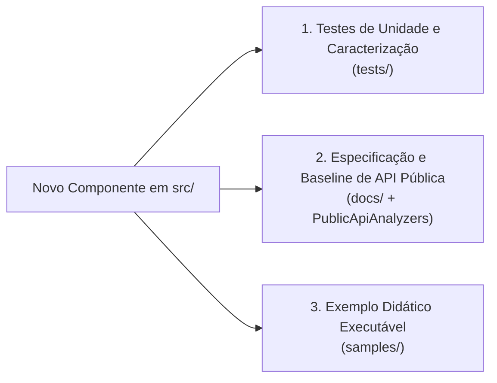

# Guia de Contribuição — Softprime.Framework

Agradecemos o interesse em contribuir com o **Softprime.Framework**! Este documento estabelece as diretrizes de governança, padrões arquiteturais, ciclo de vida do código e requisitos de qualidade para manter o framework estável, retrocompatível e de alta performance.

---

## 1. Princípios Gerais e Governança

O Softprime.Framework é o conjunto de bibliotecas fundamentais que sustenta as aplicações corporativas da Softprime. Todas as alterações devem priorizar:

1. **Retrocompatibilidade e Estabilidade:** Aplicações legadas em `.NET Framework 4.8` e sistemas em produção em `.NET 8 LTS` não podem sofrer quebras de contrato inesperadas.
2. **Separação de Responsabilidades:** Contratos e abstrações permanecem rigorosamente desacoplados de implementações de infraestrutura e provedores concretos.
3. **Imutabilidade e Rastreabilidade:** Nenhuma alteração entra no repositório sem rastreabilidade a uma issue documentada, commits semânticos e validações automáticas no CI.

---

## 2. A Regra Permanente dos Três Pilares (Novos Componentes)

> [!IMPORTANT]
> Originada da análise arquitetural comparativa ([#17]/[#22]) e formalizada nas issues [#7], [#11] e [#18]/[#23], **nenhum novo componente de biblioteca pode ser incorporado ao framework sem atender integralmente aos três pilares abaixo**:

### 1º Pilar: Testes Automatizados (`tests/`)
- Todo novo projeto em `src/` deve ter seu projeto correspondente em `tests/<NomeDoProjeto>.Tests`.
- Devem cobrir comportamentos de domínio, validações, serialização e contratos de repositório/serviço.
- Devem rodar de forma confiável e rápida na esteira de CI Windows.

### 2º Pilar: Documentação e Governança de API Pública (`docs/`)
- Todo tipo, método, propriedade e evento público ou protegido (`protected`) deve conter documentação XML (`///`) completa e escrita em **português**.
- A adição de novas APIs públicas deve ser registrada no baseline do pacote (`PublicAPI.Shipped.txt` / `PublicAPI.Unshipped.txt`) e não introduzir quebras binárias nos targets existentes ([#11]).

### 3º Pilar: Exemplo Didático Executável (`samples/`)
- Todo componente deve disponibilizar um exemplo funcional em `samples/` demonstrando seu ciclo de vida e uso idiomático ([#18], [#23]).
- **Autossuficiência Obrigatória:** Os exemplos não podem depender de credenciais privadas ou infraestrutura paga externa. Serviços como banco de dados devem usar mocks, in-memory ou SQLite temporário para viabilizar smoke tests automatizados no CI ([#21]).

---

## 3. Fluxo de Trabalho Git

### 3.1. Branches Semânticas
Toda contribuição deve ser desenvolvida em uma branch com prefixo semântico descritivo, vinculada ao número da issue de referência:

| Prefixo | Finalidade | Exemplo de Nome de Branch |
|---|---|---|
| `docs/` | Documentação, especificações, guias e diretrizes | `docs/issue-13-atualizar-diretrizes-arquitetura` |
| `feat/` | Nova funcionalidade, novo componente ou expansão de API | `feat/issue-5-modernizacao-camada-dados` |
| `fix/` | Correção de defeito, vulnerabilidade ou bug comportamental | `fix/issue-6-corrigir-vulnerabilidade-newtonsoft` |
| `test/` | Criação ou expansão de testes sem alteração em produção | `test/issue-7-adicionar-testes-domain` |
| `refactor/` | Refatoração interna de código que não altera contratos | `refactor/simplificar-helpers-criptografia` |
| `chore/` | Tarefas de manutenção, ferramentas ou dependências de build | `chore/atualizar-ferramentas-ci` |

### 3.2. Commits Semânticos (Conventional Commits)
As mensagens de commit devem seguir rigorosamente o padrão [Conventional Commits](https://www.conventionalcommits.org/):

$$\text{tipo}(\text{escopo}): \text{descrição no imperativo e minúsculas} \text{ (\#issue)}$$

- **Tipos aceitos:** `feat`, `fix`, `docs`, `test`, `refactor`, `style`, `chore`, `ci`, `perf`.
- **Exemplos válidos:**
  - `docs(kiro): atualizar diretrizes de arquitetura e targets (#13)`
  - `feat(data): adicionar implementacao de repositorio para efcore10 (#5)`
  - `fix(security): corrigir vulnerabilidade ghsa-5crp-9r3c-p9vr no cliente http (#6)`
  - `test(common): adicionar testes de caracterizacao para strings e dates (#7)`

---

## 4. Diretrizes Técnicas de Targets e Versionamento

Antes de criar um projeto ou modificar um arquivo `.csproj`, consulte os documentos normativos em `docs/`:

1. **Matriz de Compatibilidade de Targets ([`docs/target-compatibility-matrix.md`](docs/target-compatibility-matrix.md)):**
   - **Contratos e Utilitários Compartilhados (`Common`, `DAL`, `Domain`, `Api.Dto`, `Mailer`):** Alvo universal **`netstandard2.0`** (preservando `net48` nativo onde já existente).
   - **Proibição Expressa:** **`netstandard2.1` não deve ser utilizado em novos projetos** e será descontinuado nos pacotes compartilhados (não suporta `.NET Framework 4.8`).
   - **Implementações Web e Modernas (`Api`, `Multitenancy`, `EFCore10`):** Multi-targeting **`net10.0;net8.0`** utilizando `<FrameworkReference Include="Microsoft.AspNetCore.App" />`.
   - **Persistência Legada (`EF6`, `EFCore3`, `EFCore5`, `NH`):** Linhas congeladas e preservadas para sustentação de sistemas legados.

2. **Política de Versionamento NuGet ([`docs/nuget-versioning-policy.md`](docs/nuget-versioning-policy.md)):**
   - Adoção estrita de **SemVer 2.0.0** (`MAJOR.MINOR.PATCH`).
   - **Coexistência de Linhas:** Linha `2.x` mantida para sustentação de legados; evolução com novos runtimes e quebras estruturais ocorre na linha `3.x`.
   - **Dependências Estáveis:** Proibido utilizar versões em pré-release (`-rc`, `-preview`) em pacotes distribuídos. Todas as dependências devem ser pinadas em versões estáveis aprovadas.

3. **Topologia de CI/CD ([`docs/ci-pipeline-spec.md`](docs/ci-pipeline-spec.md)):**
   - A esteira oficial roda exclusivamente em runners **`windows-latest`** via PowerShell Core (`pwsh`), assegurando compilação nativa de `net48` e dos targets modernos sem problemas de paridade com servidores corporativos.
   - Todo PR deve passar com sucesso nos gates de compilação, testes e validação de pacotes (`EnablePackageValidation`).

---

## 5. Checklist de Submissão de Pull Request (PR)

Antes de abrir um PR ou solicitar revisão:

- [ ] A branch foi criada a partir da `upstream/main` mais recente com prefixo semântico adequado.
- [ ] O código compila sem erros ou novos avisos: `dotnet build src/Softprime.Framework.All.sln -c Release`.
- [ ] Todos os testes automatizados executam e passam localmente: `dotnet test`.
- [ ] Nenhum arquivo temporário, binário (`bin/`, `obj/`) ou `.nupkg` foi adicionado ao commit.
- [ ] Se houver novo componente, a **Regra dos Três Pilares** foi integralmente cumprida (`tests/`, `docs/`, `samples/`).
- [ ] A matriz de targets segue estritamente `docs/target-compatibility-matrix.md` (sem `netstandard2.1` para novos projetos).
- [ ] As mensagens de commit seguem o padrão Conventional Commits com referência à issue.
- [ ] O PR está linkado à issue correspondente (ex.: `Closes #13`).
