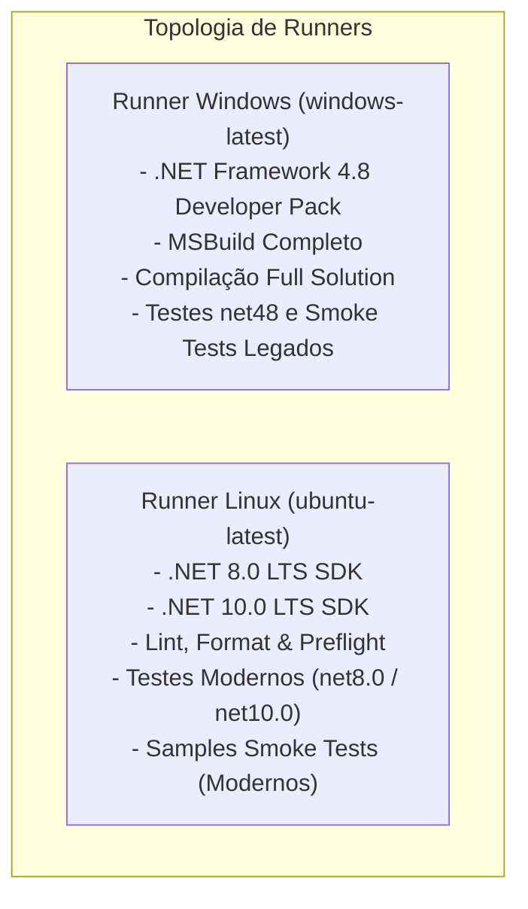
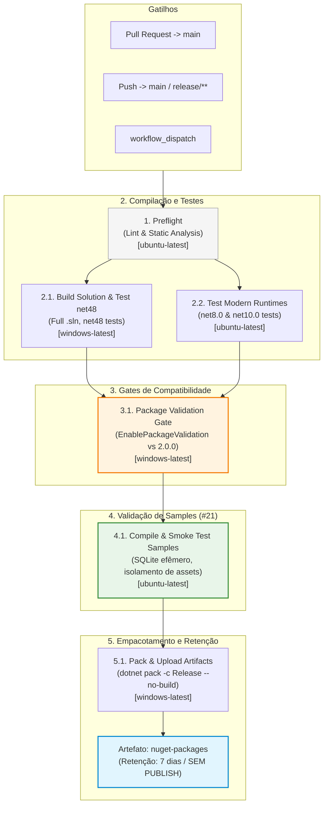
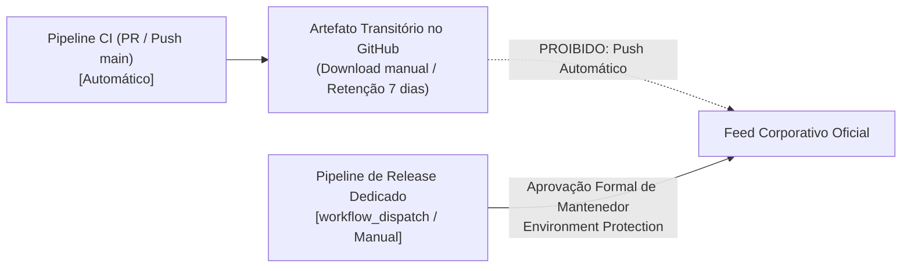

# Especificação da Esteira de Integração Contínua (CI) — Softprime.Framework

> Documento normativo de arquitetura e governança de automação · **Entregável da Issue [#8]** (Fase 1 — Definir e automatizar).  
> Alinhado à [Estratégia de Testes (`docs/test-strategy.md`)](test-strategy.md) ([#7]), à [Matriz de Compatibilidade e Targets (`docs/target-compatibility-matrix.md`)](target-compatibility-matrix.md) ([#3]), à [Estratégia de Baseline de APIs Públicas (`docs/api-baseline-strategy.md`)](api-baseline-strategy.md) ([#11]), à [Política NuGet (`docs/nuget-versioning-policy.md`)](nuget-versioning-policy.md) ([#12]), aos achados do Codout ([#17]) e à especificação de Samples ([#21]).  
> Data de aprovação: 2026-11-04 · Branch: `issue/8-configurar-ci-github-actions`

---

## 1. Princípios e Diretrizes Fundamentais

A automação de Integração Contínua (CI) do `Softprime.Framework` via **GitHub Actions** é estruturada sob 6 princípios invioláveis:

1. **Feedback Rápido e Determinístico:** Cada Pull Request ou push na branch principal deve receber retorno confiável e reproduzível sobre a integridade da compilação e dos testes antes de qualquer merge.
2. **Suporte Mandatório a `net48` via Runner Windows:** Como diversos projetos críticos da solução (`Domain`, `DAL`, `EF6`, `Multitenancy`, `Mailer`, etc.) possuem targets nativos `.NET Framework 4.8`, a compilação completa da solution e a execução da bateria de testes legada exigem obrigatoriamente um ambiente Windows (`windows-latest`).
3. **Validação Multiplataforma em Linux:** A execução de testes unitários e de integração sob os runtimes modernos (`net8.0` e `net10.0`) deve ocorrer em ambiente Linux (`ubuntu-latest`), garantindo paridade e portabilidade para deploys em contêineres e nuvem, além de otimizar tempo e custos de runner minutes.
4. **Gates Automatizados de Compatibilidade de API e Pacotes:** A esteira deve atuar como barreira ativa contra quebras silenciosas através de:
   - Análise estática de código com Roslyn `Microsoft.CodeAnalysis.PublicApiAnalyzers` (erros `RS0016` e `RS0017`).
   - Validação binária e de multi-targeting com `EnablePackageValidation` do .NET SDK ([#17]) contra o pacote publicado de baseline `2.0.0` ([#11]).
5. **Integração e Isolamento de Samples (#21):** As aplicações de exemplo (`samples/**`) devem ser compiladas e exercitadas por testes pontuais (*smoke tests*) usando banco SQLite efêmero em arquivo temporário. É expressamente proibido empacotar binários de samples nos `.nupkg` do framework.
6. **Proibição Irrevogável de Publicação Automática de Pacotes:** O pipeline de CI **nunca** executa comandos de publicação (`dotnet nuget push`) em feeds NuGet corporativos ou públicos. Os pacotes gerados em Release são preservados estritamente como artefatos temporários de build para inspeção e smoke tests locais, com retenção de **7 dias**. A publicação oficial permanece restrita a um workflow manual dedicado (`workflow_dispatch`), com *sign-off* dos mantenedores ([#12]).

> [!IMPORTANT]
> **Natureza de Planejamento (Fase 1):**  
> Em total conformidade com os critérios de aceite da issue [#8], este documento é **estritamente de especificação arquitetural**. **Nenhum arquivo `.github/workflows/*.yml` ou código de produção/teste é criado ou alterado nesta rodada**. A implementação física dos workflows ocorrerá na Fase de Desenvolvimento.

---

## 2. Topologia do Pipeline e Matriz de Runners

### 2.1. Justificativa da Topologia Híbrida (Windows + Linux)



- **Por que o Windows Runner é indispensável?**  
  O `.NET Framework 4.8` é uma tecnologia restrita ao ecossistema Windows. Ferramentas de compilação em Linux (mesmo com Mono) não oferecem paridade exata de referência de assemblies (Reference Assemblies), suporte a drivers clássicos de persistência nem suporte ao ecossistema completo de testes `net48`. Portanto, qualquer job que compile projetos com target nativo `net48` ou execute testes sob o runtime .NET Framework 4.8 deve rodar em `windows-latest`.
- **Por que utilizar o Linux Runner em paralelo?**  
  Runners Linux (`ubuntu-latest`) consomem metade dos minutos de cota do GitHub Actions em comparação com runners Windows, iniciam mais rápido e validam a portabilidade real das implementações modernas (`Softprime.Framework.Api`, `Softprime.Framework.Multitenancy`, `EFCore10`) no sistema operacional padrão de produção conteinerizada.

### 2.2. Mapeamento de Responsabilidades por Runner

| Etapa / Job | Runner | Rationale |
|---|---|---|
| **Preflight (Lint/Format)** | `ubuntu-latest` | Execução ultra-rápida de `dotnet format --verify-no-changes` e análise estática básica. |
| **Full Build & Net48 Tests** | `windows-latest` | Compilação da solution completa `src/Softprime.Framework.All.sln` contendo alvos `net48` e execução da suíte de testes legada. |
| **Modern Tests (.NET 8 / 10)** | `ubuntu-latest` | Execução dos testes unitários/integração contra runtimes .NET 8 e .NET 10 multiplataforma. |
| **Package Validation Gate** | `windows-latest` | Execução de `dotnet pack` com `EnablePackageValidation=true` contra baseline 2.0.0 (requer todos os targets construídos). |
| **Samples Smoke Tests (#21)** | `ubuntu-latest` (Linux) / `windows-latest` (se sample legado ativo) | Compilação e execução rápida de console/minimal API sample com SQLite local descartável. |
| **Pack & Artifact Upload** | `windows-latest` | Geração dos arquivos finais `.nupkg` e `.snupkg` em modo Release e upload como artefatos temporários. |

---

## 3. Arquitetura em Estágios (Pipeline Stages & Jobs)

### 3.1. Fluxo de Dependências entre Jobs



---

### 3.2. Especificação Detalhada dos Jobs

#### Job 1: `preflight` (Lint, Format & Integridade)
- **Runner:** `ubuntu-latest`
- **Tempo estimado:** < 1 minuto.
- **Passos:**
  1. Checkout do código via `actions/checkout@v4`.
  2. Instalação do .NET SDK moderno via `actions/setup-dotnet@v4`.
  3. Verificação de formatação de código:
     ```bash
     dotnet format --verify-no-changes --verbosity diagnostic
     ```
  4. Validação de consistência básica dos arquivos de projeto (ex.: ausência de referências circulares ou sintaxe XML corrompida).

#### Job 2: `build-windows` (Compilação Completa e Testes Legados)
- **Runner:** `windows-latest`
- **Tempo estimado:** 3 a 5 minutos.
- **Passos:**
  1. Checkout do código.
  2. Setup de múltiplos .NET SDKs (ex.: SDK 10.0 e SDK 8.0) com cache NuGet habilitado.
  3. Restauração de dependências:
     ```bash
     dotnet restore src/Softprime.Framework.All.sln --locked-mode
     ```
  4. Compilação da solution completa em modo Release:
     ```bash
     dotnet build src/Softprime.Framework.All.sln -c Release --no-restore -p:TreatWarningsAsErrors=true
     ```
  5. Execução dos testes unitários e de integração sob o framework `.NET Framework 4.8`:
     ```bash
     dotnet test src/Softprime.Framework.All.sln -c Release --no-build --filter "TargetFramework=net48" --logger "trx;LogFileName=test-results-net48.trx"
     ```

#### Job 3: `test-linux` (Testes em Runtimes Modernos)
- **Runner:** `ubuntu-latest`
- **Tempo estimado:** 2 a 3 minutos.
- **Passos:**
  1. Checkout do código.
  2. Setup dos SDKs modernos (.NET 8.0 e .NET 10.0) com cache.
  3. Restauração e compilação dos projetos e testes modernos.
  4. Execução dos testes sob `net8.0` e `net10.0`:
     ```bash
     dotnet test tests/Softprime.Framework.Tests.sln -c Release --filter "TargetFramework=net8.0 | TargetFramework=net10.0" --logger "trx;LogFileName=test-results-modern.trx"
     ```
  5. Publicação dos relatórios TRX de teste como artefatos de diagnóstico.

#### Job 4: `package-validation` (Gate de Compatibilidade Pública)
- **Runner:** `windows-latest`
- **Depende de:** `build-windows` e `test-linux`.
- **Passos:**
  1. Validação dos arquivos de superfícies públicas de API (`PublicAPI.Shipped.txt` e `PublicAPI.Unshipped.txt`) via compilador Roslyn ([#11]). Falhas `RS0016` (API nova não registrada) ou `RS0017` (API shipped alterada ou removida sem consentimento) quebram a esteira imediatamente.
  2. Execução da validação de pacotes pelo .NET SDK ([#17]):
     ```bash
     dotnet pack src/Softprime.Framework.All.sln -c Release --no-build -p:EnablePackageValidation=true -p:PackageValidationBaselineVersion=2.0.0
     ```
  3. O analisador compara binariamente o pacote gerado contra o pacote estável `2.0.0` do feed corporativo, bloqueando a pipeline se:
     - Qualquer membro público presente na baseline `2.0.0` tiver sido removido ou modificado.
     - Houver inconsistência de assinaturas entre as fatias `netstandard2.0` e `net10.0` de um mesmo pacote.

#### Job 5: `samples-smoke-test` (Validação de Samples — Issue #21)
- **Runner:** `ubuntu-latest` (ou `windows-latest` caso o sample opcional `99-Net48-Consumo` esteja em execução).
- **Depende de:** `package-validation`.
- **Passos:**
  1. Configuração do ambiente e SDK.
  2. Compilação de todos os projetos contidos no diretório `samples/**`:
     ```bash
     dotnet build samples/Softprime.Framework.Samples.sln -c Release
     ```
  3. Execução automatizada de *smoke tests* das aplicações de exemplo:
     - Configuração de connection string apontando para banco SQLite em arquivo temporário:
       `Data Source=${{ runner.temp }}/sample_test.db`
     - Execução do sample em modo de auto-teste ou smoke test (ex.: comando CLI ou requisição local HTTP com verificação de exit code `0`).
     - Exclusão imediata do banco temporário `${{ runner.temp }}/sample_test.db`.
  4. **Verificação de Isolamento:** Auditoria estrita garantindo que os assemblies ou arquivos gerados em `samples/**` não constem no diretório de saída de pacotes NuGet (`artifacts/packages/`).

#### Job 6: `pack-artifacts` (Empacotamento e Arquivamento de Artefatos)
- **Runner:** `windows-latest`
- **Depende de:** `samples-smoke-test`.
- **Passos:**
  1. Geração definitiva dos pacotes NuGet (`.nupkg`) e pacotes de símbolos Source Link (`.snupkg`):
     ```bash
     dotnet pack src/Softprime.Framework.All.sln -c Release --no-build --output artifacts/packages/
     ```
  2. Upload dos arquivos gerados utilizando a action oficial `actions/upload-artifact@v4`:
     - Nome do artefato: `nuget-packages-${{ github.sha }}`
     - Caminho: `artifacts/packages/*`
     - Retenção: **7 dias** (expiração automática).
  3. **Invariante de Não-Publicação:** Nenhum comando `dotnet nuget push` é executado neste workflow.

---

## 4. Gatilhos, Concorrência e Filtros de Execução

### 4.1. Gatilhos de Execução (Triggers)
A esteira principal de CI será acionada nos seguintes eventos:

1. **Pull Requests:**
   - Eventos: `opened`, `synchronize`, `reopened`.
   - Branches alvo: `main` e `release/**`.
2. **Push Direto:**
   - Branches: `main` e `release/**`.
3. **Execução Manual (`workflow_dispatch`):**
   - Permite acionar a esteira sob demanda para depuração ou validação de branches de feature antes da abertura de PRs.

### 4.2. Filtros de Caminho (Path Filters)
Para poupar minutos de runner e evitar execuções desnecessárias, commits que alterem exclusivamente arquivos que não afetam a compilação ou execução do framework devem ignorar o CI:

```yaml
paths-ignore:
  - 'docs/**'
  - '*.md'
  - '.gitignore'
  - 'LICENSE.txt'
  - '.kiro/**'
```

### 4.3. Concorrência e Cancelamento Automático
Para evitar acúmulo de execuções redundantes quando múltiplos commits são enviados em rápida sucessão na mesma branch de Pull Request:

```yaml
concurrency:
  group: ci-${{ github.workflow }}-${{ github.ref }}
  cancel-in-progress: ${{ github.ref != 'refs/heads/main' }}
```

*(Em branches protegidas como a `main`, execuções em andamento não são canceladas para assegurar o histórico contínuo de build).*

---

## 5. Estratégia de Cache e Desempenho

O tempo de restauração de pacotes NuGet em solutions com múltiplos projetos pode ser otimizado através de cache distribuído.

### 5.1. Chave de Cache de Pacotes Globais NuGet
A esteira configurará cache dos diretórios de pacotes globais do NuGet:
- **Linux:** `~/.nuget/packages`
- **Windows:** `%userprofile%\.nuget\packages`

Chave de cache recomendada:
```yaml
key: ${{ runner.os }}-nuget-${{ hashFiles('src/**/*.csproj', 'src/Directory.Build.props', 'src/Directory.Packages.props') }}
restore-keys: |
  ${{ runner.os }}-nuget-
```

### 5.2. Otimizações de Compilação
- Uso consistente da flag `--no-restore` nos passos subsequentes ao `dotnet restore`.
- Uso da flag `--no-build` nos passos de teste e empacotamento, aproveitando os binários compilados previamente.
- Execução de testes em paralelo através da engine do xUnit (`parallelizeAssembly = true`).

---

## 6. Governança de Artefatos e Não-Publicação (#12)

### 6.1. O Princípio "No-Push" no CI
Em conformidade com a seção 6 da [Política NuGet (`docs/nuget-versioning-policy.md`)](nuget-versioning-policy.md), nenhuma esteira contínua de PR ou de push possui permissão para publicar pacotes no feed estável ou corporativo:



### 6.2. Proteção de Credenciais e Segredos
- O pipeline de CI **não possui acesso** a secrets de publicação (ex.: `NUGET_API_KEY`).
- Segredos de publicação serão configurados exclusivamente dentro do ambiente protegido (*GitHub Environment*) `nuget-production`, acessível apenas pelo workflow dedicado de release.

---

## 7. Modelo Conceitual do Workflow (`ci.yml`)

> [!NOTE]
> O manifesto YAML abaixo constitui a **especificação técnica de referência** projetada para orientar a implementação física do workflow no início da Fase de Desenvolvimento.

```yaml
# ==============================================================================
# ESPECIFICAÇÃO DE WORKFLOW — Softprime.Framework CI
# Entregável de Planejamento da Issue #8 (NÃO EXECUTAR NESTA RODADA)
# ==============================================================================
name: CI Pipeline

on:
  push:
    branches: [ main, 'release/**' ]
    paths-ignore:
      - 'docs/**'
      - '*.md'
      - '.gitignore'
      - 'LICENSE.txt'
      - '.kiro/**'
  pull_request:
    branches: [ main, 'release/**' ]
    paths-ignore:
      - 'docs/**'
      - '*.md'
      - '.gitignore'
      - 'LICENSE.txt'
      - '.kiro/**'
  workflow_dispatch:

concurrency:
  group: ci-${{ github.workflow }}-${{ github.ref }}
  cancel-in-progress: ${{ github.ref != 'refs/heads/main' }}

permissions:
  contents: read
  packages: none # Sem permissão de escrita de pacotes

jobs:
  preflight:
    name: Lint & Code Style
    runs-on: ubuntu-latest
    steps:
      - name: Checkout Code
        uses: actions/checkout@v4

      - name: Setup .NET SDK
        uses: actions/setup-dotnet@v4
        with:
          dotnet-version: '10.0.x'

      - name: Check Code Formatting
        run: dotnet format --verify-no-changes --verbosity diagnostic

  build-windows:
    name: Build & Test (Windows - Full Solution & net48)
    needs: preflight
    runs-on: windows-latest
    steps:
      - name: Checkout Code
        uses: actions/checkout@v4

      - name: Setup .NET SDKs
        uses: actions/setup-dotnet@v4
        with:
          dotnet-version: |
            8.0.x
            10.0.x
          cache: true

      - name: Restore Dependencies
        run: dotnet restore src/Softprime.Framework.All.sln

      - name: Build Solution (Release)
        run: dotnet build src/Softprime.Framework.All.sln -c Release --no-restore -p:TreatWarningsAsErrors=true

      - name: Run net48 Tests
        run: dotnet test src/Softprime.Framework.All.sln -c Release --no-build --filter "TargetFramework=net48" --logger "trx"

  test-linux:
    name: Test Modern Targets (.NET 8/10)
    needs: preflight
    runs-on: ubuntu-latest
    steps:
      - name: Checkout Code
        uses: actions/checkout@v4

      - name: Setup .NET SDKs
        uses: actions/setup-dotnet@v4
        with:
          dotnet-version: |
            8.0.x
            10.0.x
          cache: true

      - name: Restore & Build Tests
        run: |
          dotnet restore tests/Softprime.Framework.Tests.sln
          dotnet build tests/Softprime.Framework.Tests.sln -c Release --no-restore

      - name: Run Modern Tests (net8.0 & net10.0)
        run: dotnet test tests/Softprime.Framework.Tests.sln -c Release --no-build --filter "TargetFramework=net8.0 | TargetFramework=net10.0" --logger "trx"

  package-validation:
    name: Package Validation & API Surface Gate
    needs: [build-windows, test-linux]
    runs-on: windows-latest
    steps:
      - name: Checkout Code
        uses: actions/checkout@v4

      - name: Setup .NET SDK
        uses: actions/setup-dotnet@v4
        with:
          dotnet-version: '10.0.x'

      - name: Validate API Surface & Compatibility vs Baseline 2.0.0
        run: >
          dotnet pack src/Softprime.Framework.All.sln -c Release --no-build
          -p:EnablePackageValidation=true
          -p:PackageValidationBaselineVersion=2.0.0

  samples-smoke-test:
    name: Samples Compilation & Smoke Test (#21)
    needs: package-validation
    runs-on: ubuntu-latest
    steps:
      - name: Checkout Code
        uses: actions/checkout@v4

      - name: Setup .NET SDK
        uses: actions/setup-dotnet@v4
        with:
          dotnet-version: |
            8.0.x
            10.0.x

      - name: Restore and Build Samples
        run: dotnet build samples/Softprime.Framework.Samples.sln -c Release

      - name: Run Samples Smoke Test (Ephemeral SQLite)
        run: |
          export SAMPLE_DB_PATH="${{ runner.temp }}/sample_smoke.db"
          dotnet run --project samples/01-WebApp-Modern/WebApp-Modern.csproj -c Release --no-build -- --smoke-test
          rm -f "${{ runner.temp }}/sample_smoke.db"

  pack-artifacts:
    name: Pack & Upload Artifacts (No Publish)
    needs: samples-smoke-test
    runs-on: windows-latest
    steps:
      - name: Checkout Code
        uses: actions/checkout@v4

      - name: Setup .NET SDK
        uses: actions/setup-dotnet@v4
        with:
          dotnet-version: '10.0.x'

      - name: Pack All Packages (Release)
        run: dotnet pack src/Softprime.Framework.All.sln -c Release --no-build --output artifacts/packages/

      - name: Audit Packages (Ensure samples are excluded)
        shell: pwsh
        run: |
          $packages = Get-ChildItem -Path artifacts/packages/*.nupkg
          Write-Host "Found $($packages.Count) packages produced."
          foreach ($pkg in $packages) {
            if ($pkg.Name -match "Sample") {
              Write-Error "Sample package detected in release directory: $($pkg.Name)"
              exit 1
            }
          }

      - name: Upload Build Artifacts
        uses: actions/upload-artifact@v4
        with:
          name: nuget-packages-${{ github.sha }}
          path: artifacts/packages/*
          retention-days: 7
```

---

## 8. Resumo Operacional para Desenvolvedores

| Situação | Ação / Comportamento do CI |
|---|---|
| **Abri um PR alterando apenas `.md` ou documentação** | O CI **não é acionado**, economizando tempo e quota de runners. |
| **Adicionei ou renomeei um método público em `Domain` ou `DAL`** | O job `package-validation` falhará se houver quebra de API pública não documentada nos arquivos `PublicAPI.*.txt` ou na validação `EnablePackageValidation`. |
| **Um teste `net48` falha, mas passa em `net10.0`** | O job `build-windows` quebra a esteira, garantindo que a retrocompatibilidade com aplicações legadas não seja violada. |
| **A compilação do sample falha após alteração no framework** | O job `samples-smoke-test` quebra o PR antes de qualquer merge, impedindo o apodrecimento dos exemplos de uso ([#21]). |
| **Onde baixo os pacotes `.nupkg` gerados pelo meu PR?** | Na aba **Summary** da execução da Actions, no artefato `nuget-packages-<sha>` (disponível por 7 dias). |
| **O CI publicou os pacotes no NuGet automaticamente?** | **Não.** O CI nunca publica pacotes. Publicações são manuais via *workflow_dispatch* com aprovação de mantenedores ([#12]). |

---

<!-- Links de Referência -->
[#3]: https://github.com/softprime/Softprime.Framework/issues/3
[#7]: https://github.com/softprime/Softprime.Framework/issues/7
[#8]: https://github.com/softprime/Softprime.Framework/issues/8
[#10]: https://github.com/softprime/Softprime.Framework/issues/10
[#11]: https://github.com/softprime/Softprime.Framework/issues/11
[#12]: https://github.com/softprime/Softprime.Framework/issues/12
[#17]: https://github.com/softprime/Softprime.Framework/issues/17
[#21]: https://github.com/softprime/Softprime.Framework/issues/21
