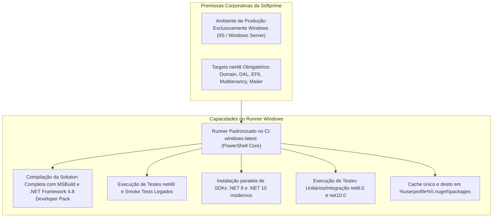
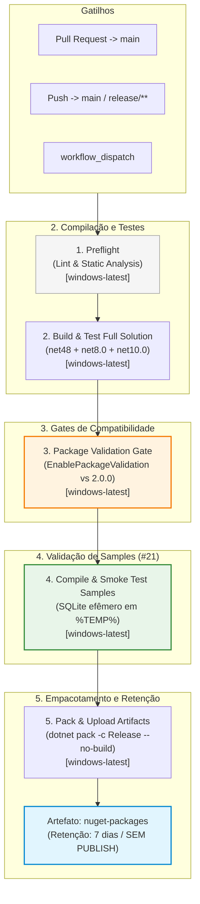
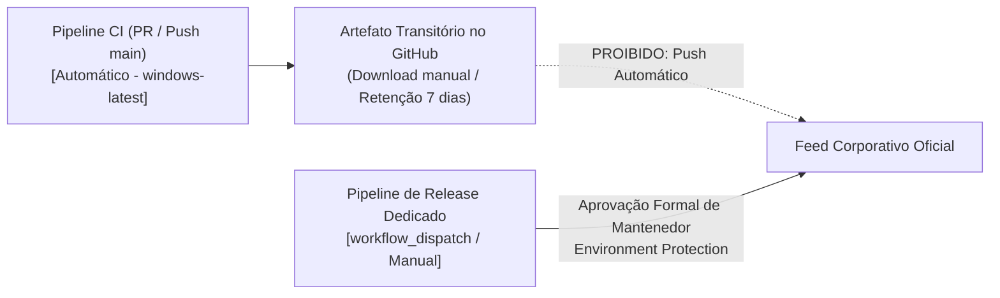

# Especificação da Esteira de Integração Contínua (CI) — Softprime.Framework

> Documento normativo de arquitetura e governança de automação · **Entregável da Issue [#8]** (Fase 1 — Definir e automatizar).  
> Alinhado à [Estratégia de Testes (`docs/test-strategy.md`)](test-strategy.md) ([#7]), à [Matriz de Compatibilidade e Targets (`docs/target-compatibility-matrix.md`)](target-compatibility-matrix.md) ([#3]), à [Estratégia de Baseline de APIs Públicas (`docs/api-baseline-strategy.md`)](api-baseline-strategy.md) ([#11]), à [Política NuGet (`docs/nuget-versioning-policy.md`)](nuget-versioning-policy.md) ([#12]), aos achados do Codout ([#17]) e à especificação de Samples ([#21]).  
> Data de aprovação: 2026-11-04 · Branch: `issue/8-configurar-ci-github-actions`

---

## 1. Princípios e Diretrizes Fundamentais

A automação de Integração Contínua (CI) do `Softprime.Framework` via **GitHub Actions** é estruturada sob 5 princípios fundamentais:

1. **Feedback Rápido e Determinístico:** Cada Pull Request ou push na branch principal deve receber retorno confiável e reproduzível sobre a integridade da compilação e dos testes antes de qualquer merge.
2. **Topologia Unificada 100% Windows (`windows-latest`):** Como os sistemas corporativos e consumidores da Softprime operam **exclusivamente em ambiente Windows** (Windows Server e IIS), e projetos essenciais possuem targets nativos `.NET Framework 4.8`, a esteira adota uma topologia padronizada em runners Windows. Isso assegura paridade absoluta com o ambiente real de produção, elimina custos de manutenção de ambientes heterogêneos e evita falsos positivos (ex.: inconsistências de *case sensitivity* em sistemas de arquivos ou diferenças de cultura).
3. **Validação Completa de Runtimes (Legado e Moderno):** O runner Windows compila e executa tanto a bateria de testes de `.NET Framework 4.8` quanto os testes nos runtimes modernos (`net8.0` e `net10.0`), além dos contratos `netstandard2.0`, garantindo estabilidade e retrocompatibilidade em um pipeline coeso e direto.
4. **Gates Automatizados de Compatibilidade de API e Pacotes:** A esteira atua como barreira ativa contra quebras silenciosas através de:
   - Análise estática de código com Roslyn `Microsoft.CodeAnalysis.PublicApiAnalyzers` (erros `RS0016` e `RS0017`).
   - Validação binária e de multi-targeting com `EnablePackageValidation` do .NET SDK ([#17]) contra o pacote publicado de baseline `2.0.0` ([#11]).
5. **Integração e Isolamento de Samples (#21):** As aplicações de exemplo (`samples/**`) devem ser compiladas e exercitadas por testes pontuais (*smoke tests*) usando banco SQLite efêmero em arquivo temporário no runner. É expressamente proibido empacotar binários de samples nos `.nupkg` do framework.
6. **Proibição Irrevogável de Publicação Automática de Pacotes:** O pipeline de CI **nunca** executa comandos de publicação (`dotnet nuget push`) em feeds NuGet corporativos ou públicos. Os pacotes gerados em Release são preservados estritamente como artefatos temporários de build para inspeção e smoke tests locais, com retenção de **7 dias**. A publicação oficial permanece restrita a um workflow manual dedicado (`workflow_dispatch`), com *sign-off* dos mantenedores ([#12]).

> [!IMPORTANT]
> **Natureza de Planejamento (Fase 1):**  
> Em total conformidade com os critérios de aceite da issue [#8], este documento é **estritamente de especificação arquitetural**. **Nenhum arquivo `.github/workflows/*.yml` ou código de produção/teste é criado ou alterado nesta rodada**. A implementação física dos workflows ocorrerá na Fase de Desenvolvimento.

---

## 2. Topologia do Pipeline e Decisão de Runner

### 2.1. Justificativa da Escolha por 100% Windows (`windows-latest`)



- **Fidelidade à Realidade de Produção:** Não há servidores Linux ou contêineres Linux em uso na operação corporativa. Testar em Linux introduziria discrepâncias artificiais (ex.: resolução de caminhos com barra invertida `\` vs `/`, distinção de maiúsculas/minúsculas em nomes de arquivos, ou dependências de bibliotecas de sistema C).
- **Eliminação de Duplicidade:** O runner Windows é obrigatório para compilar e testar `net48`. Utilizá-lo para todos os estágios do pipeline simplifica drasticamente a esteira, que passa a ter um único tipo de runner, scripts padronizados em PowerShell (`pwsh`) e um cache de dependências consolidado.

### 2.2. Mapeamento de Responsabilidades dos Jobs (100% Windows)

| Etapa / Job | Runner | Rationale |
|---|---|---|
| **Preflight (Lint/Format)** | `windows-latest` | Validação de estilo e integridade via `dotnet format --verify-no-changes` em PowerShell. |
| **Full Build & Test (All Targets)** | `windows-latest` | Compilação da solution completa `src/Softprime.Framework.All.sln` e execução de testes em `net48`, `net8.0` e `net10.0`. |
| **Package Validation Gate** | `windows-latest` | Execução de `dotnet pack` com `EnablePackageValidation=true` contra baseline `2.0.0` e análise de APIs públicas Roslyn. |
| **Samples Smoke Tests (#21)** | `windows-latest` | Compilação e execução rápida das aplicações de exemplo em `samples/**` com SQLite temporário em `%TEMP%`. |
| **Pack & Artifact Upload** | `windows-latest` | Geração dos pacotes `.nupkg` e `.snupkg` em modo Release e upload como artefatos temporários (retenção 7 dias). |

---

## 3. Arquitetura em Estágios (Pipeline Stages & Jobs)

### 3.1. Fluxo de Dependências entre Jobs



---

### 3.2. Especificação Detalhada dos Jobs

#### Job 1: `preflight` (Lint, Format & Integridade)
- **Runner:** `windows-latest`
- **Shell:** `pwsh`
- **Tempo estimado:** < 1 minuto.
- **Passos:**
  1. Checkout do código via `actions/checkout@v4`.
  2. Instalação do .NET SDK moderno via `actions/setup-dotnet@v4`.
  3. Verificação de formatação de código:
     ```powershell
     dotnet format --verify-no-changes --verbosity diagnostic
     ```
  4. Validação de consistência básica dos arquivos de projeto (ausência de referências circulares ou XML corrompido).

#### Job 2: `build-and-test` (Compilação Completa e Testes de Todos os Targets)
- **Runner:** `windows-latest`
- **Shell:** `pwsh`
- **Tempo estimado:** 4 a 6 minutos.
- **Passos:**
  1. Checkout do código.
  2. Setup de múltiplos .NET SDKs (.NET SDK 8.0 e .NET SDK 10.0) com cache NuGet habilitado.
  3. Restauração de dependências da solution completa:
     ```powershell
     dotnet restore src/Softprime.Framework.All.sln
     ```
  4. Compilação da solution completa em modo Release com tratamento rigoroso de avisos:
     ```powershell
     dotnet build src/Softprime.Framework.All.sln -c Release --no-restore -p:TreatWarningsAsErrors=true
     ```
  5. Execução dos testes unitários e de integração para o runtime legado `.NET Framework 4.8`:
     ```powershell
     dotnet test src/Softprime.Framework.All.sln -c Release --no-build --filter "TargetFramework=net48" --logger "trx;LogFileName=test-results-net48.trx"
     ```
  6. Execução dos testes unitários e de integração para os runtimes modernos (`net8.0` e `net10.0`):
     ```powershell
     dotnet test src/Softprime.Framework.All.sln -c Release --no-build --filter "TargetFramework=net8.0 | TargetFramework=net10.0" --logger "trx;LogFileName=test-results-modern.trx"
     ```
  7. Publicação dos relatórios TRX de teste como artefatos de diagnóstico para análise de falhas.

#### Job 3: `package-validation` (Gate de Compatibilidade Pública)
- **Runner:** `windows-latest`
- **Shell:** `pwsh`
- **Depende de:** `build-and-test`.
- **Passos:**
  1. Validação dos arquivos de superfícies públicas de API (`PublicAPI.Shipped.txt` e `PublicAPI.Unshipped.txt`) via compilador Roslyn ([#11]). Falhas `RS0016` (API nova não registrada) ou `RS0017` (API shipped alterada ou removida sem consentimento) quebram a esteira imediatamente.
  2. Execução da validação binária de pacotes pelo .NET SDK ([#17]):
     ```powershell
     dotnet pack src/Softprime.Framework.All.sln -c Release --no-build -p:EnablePackageValidation=true -p:PackageValidationBaselineVersion=2.0.0
     ```
  3. O analisador compara binariamente o pacote gerado contra o pacote estável `2.0.0` do feed corporativo, bloqueando a pipeline se:
     - Qualquer membro público presente na baseline `2.0.0` tiver sido removido ou modificado.
     - Houver inconsistência de assinaturas entre as fatias `netstandard2.0` e `net10.0` de um mesmo pacote.

#### Job 4: `samples-smoke-test` (Validação de Samples — Issue #21)
- **Runner:** `windows-latest`
- **Shell:** `pwsh`
- **Depende de:** `package-validation`.
- **Passos:**
  1. Configuração do ambiente e SDKs.
  2. Compilação de todos os projetos contidos no diretório `samples/**`:
     ```powershell
     dotnet build samples/Softprime.Framework.Samples.sln -c Release
     ```
  3. Execução automatizada de *smoke tests* das aplicações de exemplo:
     - Definição de connection string apontando para banco SQLite em arquivo temporário descartável no Windows:
       `$dbPath = "$env:TEMP\sample_smoke_$([Guid]::NewGuid()).db"`
     - Execução do sample em modo de auto-teste ou smoke test com verificação de exit code `0`.
     - Exclusão do arquivo de banco temporário no bloco `finally`.
  4. **Verificação de Isolamento:** Auditoria estrita garantindo que os assemblies ou arquivos gerados em `samples/**` não constem no diretório de saída de pacotes NuGet (`artifacts/packages/`).

#### Job 5: `pack-artifacts` (Empacotamento e Arquivamento de Artefatos)
- **Runner:** `windows-latest`
- **Shell:** `pwsh`
- **Depende de:** `samples-smoke-test`.
- **Passos:**
  1. Geração definitiva dos pacotes NuGet (`.nupkg`) e pacotes de símbolos Source Link (`.snupkg`):
     ```powershell
     dotnet pack src/Softprime.Framework.All.sln -c Release --no-build --output artifacts/packages/
     ```
  2. Upload dos arquivos gerados utilizando a action oficial `actions/upload-artifact@v4`:
     - Nome do artefato: `nuget-packages-${{ github.sha }}`, com retenção de **7 dias**.
  3. **Invariante de Não-Publicação:** Nenhum comando `dotnet nuget push` é executado neste workflow.

---

## 4. Gatilhos, Concorrência e Filtros de Execução

### 4.1. Gatilhos de Execução (Triggers)
A esteira principal de CI será acionada nos seguintes eventos:

1. **Pull Requests:**
   - Eventos: `opened`, `synchronize`, `reopened`.
   - Branches alvo: `main` e `release/**`.
2. **Push Direto:**
   - Branches: `main` e `release/**`.
3. **Execução Manual (`workflow_dispatch`):**
   - Permite acionar a esteira sob demanda para depuração antes de abrir PRs.

### 4.2. Filtros de Caminho (Path Filters)
Commits que alterem exclusivamente arquivos que não afetam a compilação ou execução do framework ignoram o CI:

```yaml
paths-ignore:
  - 'docs/**'
  - '*.md'
  - '.gitignore'
  - 'LICENSE.txt'
  - '.kiro/**'
```

### 4.3. Concorrência e Cancelamento Automático
Para evitar acúmulo de execuções redundantes quando novos commits são enviados na mesma branch de Pull Request:

```yaml
concurrency:
  group: ci-${{ github.workflow }}-${{ github.ref }}
  cancel-in-progress: ${{ github.ref != 'refs/heads/main' }}
```

---

## 5. Estratégia de Cache e Desempenho

### 5.1. Cache Unificado de Pacotes NuGet (Windows)
A esteira configura cache unificado do diretório de pacotes globais do NuGet em ambiente Windows:
- **Caminho:** `%userprofile%\.nuget\packages`

Chave de cache recomendada:
```yaml
key: windows-nuget-${{ hashFiles('src/**/*.csproj', 'src/Directory.Build.props', 'src/Directory.Packages.props') }}
restore-keys: |
  windows-nuget-
```

### 5.2. Otimizações de Compilação
- Uso consistente da flag `--no-restore` nos passos subsequentes ao `dotnet restore`.
- Uso da flag `--no-build` nos passos de teste e empacotamento, aproveitando os binários compilados previamente.
- Execução de testes em paralelo através da engine do xUnit (`parallelizeAssembly = true`).

---

## 6. Governança de Artefatos e Não-Publicação (#12)

### 6.1. O Princípio "No-Push" no CI
Em conformidade com a seção 6 da [Política NuGet (`docs/nuget-versioning-policy.md`)](nuget-versioning-policy.md), nenhuma esteira contínua de PR ou de push possui permissão para publicar pacotes no feed estável ou corporativo:



### 6.2. Proteção de Credenciais e Segredos
- O pipeline de CI **não possui acesso** a secrets de publicação (ex.: `NUGET_API_KEY`).
- Segredos de publicação serão configurados exclusivamente dentro do ambiente protegido (*GitHub Environment*) `nuget-production`, acessível apenas pelo workflow dedicado de release.

---

## 7. Modelo Conceitual do Workflow (`ci.yml`)

> [!NOTE]
> O manifesto YAML abaixo constitui a **especificação técnica de referência 100% Windows** projetada para orientar a implementação física do workflow no início da Fase de Desenvolvimento.

```yaml
# ==============================================================================
# ESPECIFICAÇÃO DE WORKFLOW — Softprime.Framework CI (100% Windows)
# Entregável de Planejamento da Issue #8 (NÃO EXECUTAR NESTA RODADA)
# ==============================================================================
name: CI Pipeline

on:
  push:
    branches: [ main, 'release/**' ]
    paths-ignore:
      - 'docs/**'
      - '*.md'
      - '.gitignore'
      - 'LICENSE.txt'
      - '.kiro/**'
  pull_request:
    branches: [ main, 'release/**' ]
    paths-ignore:
      - 'docs/**'
      - '*.md'
      - '.gitignore'
      - 'LICENSE.txt'
      - '.kiro/**'
  workflow_dispatch:

concurrency:
  group: ci-${{ github.workflow }}-${{ github.ref }}
  cancel-in-progress: ${{ github.ref != 'refs/heads/main' }}

permissions:
  contents: read
  packages: none # Sem permissão de escrita de pacotes

defaults:
  run:
    shell: pwsh

jobs:
  preflight:
    name: Lint & Code Style
    runs-on: windows-latest
    steps:
      - name: Checkout Code
        uses: actions/checkout@v4

      - name: Setup .NET SDK
        uses: actions/setup-dotnet@v4
        with:
          dotnet-version: '10.0.x'

      - name: Check Code Formatting
        run: dotnet format --verify-no-changes --verbosity diagnostic

  build-and-test:
    name: Build & Test (All Targets: net48, net8.0, net10.0)
    needs: preflight
    runs-on: windows-latest
    steps:
      - name: Checkout Code
        uses: actions/checkout@v4

      - name: Setup .NET SDKs
        uses: actions/setup-dotnet@v4
        with:
          dotnet-version: |
            8.0.x
            10.0.x
          cache: true

      - name: Restore Dependencies
        run: dotnet restore src/Softprime.Framework.All.sln

      - name: Build Solution (Release)
        run: dotnet build src/Softprime.Framework.All.sln -c Release --no-restore -p:TreatWarningsAsErrors=true

      - name: Run net48 Tests
        run: dotnet test src/Softprime.Framework.All.sln -c Release --no-build --filter "TargetFramework=net48" --logger "trx;LogFileName=test-results-net48.trx"

      - name: Run Modern Tests (net8.0 & net10.0)
        run: dotnet test src/Softprime.Framework.All.sln -c Release --no-build --filter "TargetFramework=net8.0 | TargetFramework=net10.0" --logger "trx;LogFileName=test-results-modern.trx"

      - name: Upload Test Results
        uses: actions/upload-artifact@v4
        if: always()
        with:
          name: test-results-${{ github.sha }}
          path: '**/TestResults/*.trx'
          retention-days: 7

  package-validation:
    name: Package Validation & API Surface Gate
    needs: build-and-test
    runs-on: windows-latest
    steps:
      - name: Checkout Code
        uses: actions/checkout@v4

      - name: Setup .NET SDK
        uses: actions/setup-dotnet@v4
        with:
          dotnet-version: '10.0.x'

      - name: Validate API Surface & Compatibility vs Baseline 2.0.0
        run: >
          dotnet pack src/Softprime.Framework.All.sln -c Release --no-build
          -p:EnablePackageValidation=true
          -p:PackageValidationBaselineVersion=2.0.0

  samples-smoke-test:
    name: Samples Compilation & Smoke Test (#21)
    needs: package-validation
    runs-on: windows-latest
    steps:
      - name: Checkout Code
        uses: actions/checkout@v4

      - name: Setup .NET SDK
        uses: actions/setup-dotnet@v4
        with:
          dotnet-version: |
            8.0.x
            10.0.x

      - name: Restore and Build Samples
        run: dotnet build samples/Softprime.Framework.Samples.sln -c Release

      - name: Run Samples Smoke Test (Ephemeral SQLite)
        run: |
          $tempDb = "$env:TEMP\sample_smoke_$([Guid]::NewGuid()).db"
          try {
            $env:SAMPLE_DB_PATH = $tempDb
            dotnet run --project samples/01-WebApp-Modern/WebApp-Modern.csproj -c Release --no-build -- --smoke-test
          }
          finally {
            if (Test-Path $tempDb) {
              Remove-Item -Force $tempDb
            }
          }

  pack-artifacts:
    name: Pack & Upload Artifacts (No Publish)
    needs: samples-smoke-test
    runs-on: windows-latest
    steps:
      - name: Checkout Code
        uses: actions/checkout@v4

      - name: Setup .NET SDK
        uses: actions/setup-dotnet@v4
        with:
          dotnet-version: '10.0.x'

      - name: Pack All Packages (Release)
        run: dotnet pack src/Softprime.Framework.All.sln -c Release --no-build --output artifacts/packages/

      - name: Audit Packages (Ensure samples are excluded)
        run: |
          $packages = Get-ChildItem -Path artifacts/packages/*.nupkg
          Write-Host "Found $($packages.Count) packages produced."
          foreach ($pkg in $packages) {
            if ($pkg.Name -match "Sample") {
              Write-Error "Sample package detected in release directory: $($pkg.Name)"
              exit 1
            }
          }

      - name: Upload Build Artifacts
        uses: actions/upload-artifact@v4
        with:
          name: nuget-packages-${{ github.sha }}
          path: artifacts/packages/*
          retention-days: 7
```

---

## 8. Resumo Operacional para Desenvolvedores

| Situação | Ação / Comportamento do CI |
|---|---|
| **Abri um PR alterando apenas `.md` ou documentação** | O CI **não é acionado**, economizando tempo e recursos da esteira. |
| **Adicionei ou renomeei um método público em `Domain` ou `DAL`** | O job `package-validation` falhará se houver quebra de API pública não documentada nos arquivos `PublicAPI.*.txt` ou na validação `EnablePackageValidation`. |
| **Um teste `net48` falha, mas passa em `net10.0`** | O job `build-and-test` quebra a esteira, garantindo que a retrocompatibilidade com aplicações legadas não seja violada. |
| **A compilação do sample falha após alteração no framework** | O job `samples-smoke-test` quebra o PR antes de qualquer merge, impedindo o apodrecimento dos exemplos de uso ([#21]). |
| **Por que a esteira roda 100% em Windows?** | Para garantir paridade exata com os servidores de produção (IIS e Windows Server) e suportar os alvos nativos `net48` sem falsos positivos de Linux. |
| **Onde baixo os pacotes `.nupkg` gerados pelo meu PR?** | Na aba **Summary** da execução da Actions, no artefato `nuget-packages-<sha>` (disponível por 7 dias). |
| **O CI publicou os pacotes no NuGet automaticamente?** | **Não.** O CI nunca publica pacotes. Publicações são manuais via *workflow_dispatch* com aprovação formal de mantenedores ([#12]). |

---

<!-- Links de Referência -->
[#3]: https://github.com/softprime/Softprime.Framework/issues/3
[#7]: https://github.com/softprime/Softprime.Framework/issues/7
[#8]: https://github.com/softprime/Softprime.Framework/issues/8
[#10]: https://github.com/softprime/Softprime.Framework/issues/10
[#11]: https://github.com/softprime/Softprime.Framework/issues/11
[#12]: https://github.com/softprime/Softprime.Framework/issues/12
[#17]: https://github.com/softprime/Softprime.Framework/issues/17
[#21]: https://github.com/softprime/Softprime.Framework/issues/21
