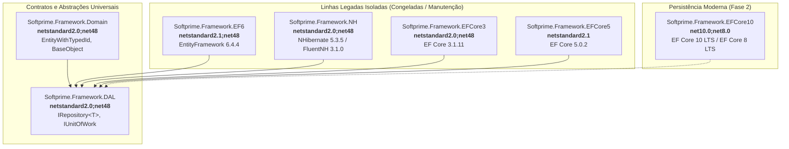
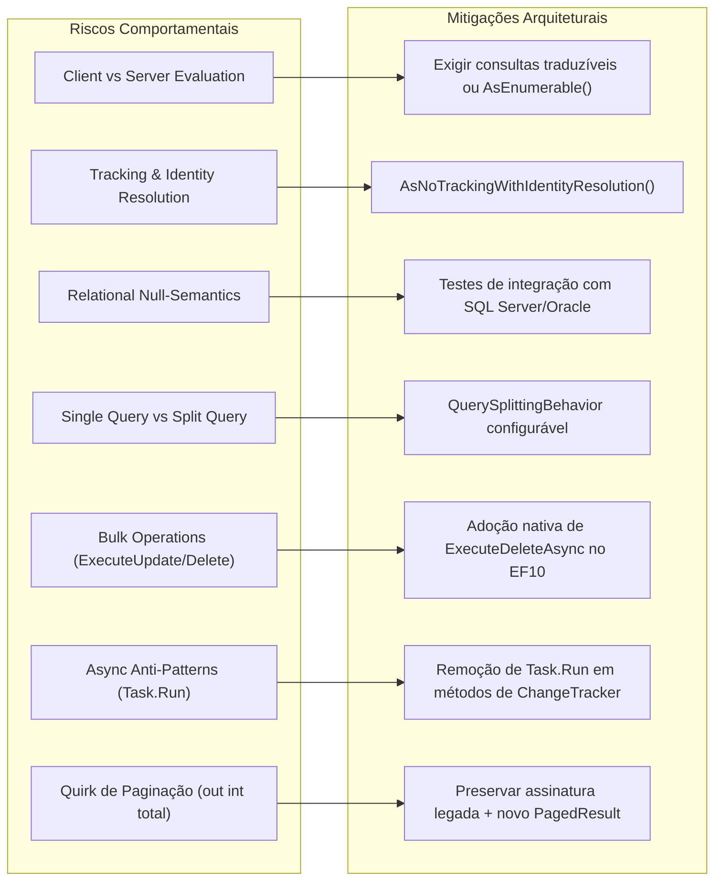

# Plano de Modernização da Camada de Dados — Softprime.Framework

> Documento de referência técnica e arquitetural · **Entregável da Issue [#5]** (Fase 2 — Modernizar seletivamente).  
> Baseado nos achados do [Inventário de Consumidores e Dependências (`docs/package-inventory.md`)](package-inventory.md) ([#10]), da [Estratégia de Baseline de APIs Públicas (`docs/api-baseline-strategy.md`)](api-baseline-strategy.md) ([#11]), da [Matriz de Compatibilidade e Estratégia de Targets (`docs/target-compatibility-matrix.md`)](target-compatibility-matrix.md) ([#3]), da [Política de Versionamento e Publicação NuGet (`docs/nuget-versioning-policy.md`)](nuget-versioning-policy.md) ([#12]), da [Estratégia de Testes (`docs/test-strategy.md`)](test-strategy.md) ([#7]), do [Planejamento de CI (`docs/ci-pipeline-spec.md`)](ci-pipeline-spec.md) ([#8]) e do [Plano de Modernização Web (`docs/aspnetcore-modernization-plan.md`)](aspnetcore-modernization-plan.md) ([#4]).  
> Data: 2026-11-05 · Branch: `feat/issue-5-modernizacao-camada-dados`

---

## Sumário

- [1. Contexto e Diagnóstico Atual (Fatos Verificados)](#1-contexto-e-diagnóstico-atual-fatos-verificados)
- [2. Mapeamento de Consumidores e Dependências por Linha (#10)](#2-mapeamento-de-consumidores-e-dependências-por-linha-10)
- [3. Decisão Arquitetural e Ciclo de Vida por Linha de Persistência](#3-decisão-arquitetural-e-ciclo-de-vida-por-linha-de-persistência)
- [4. Avaliação Aprofundada de Riscos Comportamentais entre Versões de ORM](#4-avaliação-aprofundada-de-riscos-comportamentais-entre-versões-de-orm)
- [5. Especificação Arquitetural da Nova Biblioteca Softprime.Framework.EFCore10](#5-especificação-arquitetural-da-nova-biblioteca-softprimeframeworkefcore10)
- [6. Estratégia de Testes e Homologação da Camada de Dados (#7, #11)](#6-estratégia-de-testes-e-homologação-da-camada-de-dados-7-11)
- [7. Rastreabilidade com Backlog e Próximos Passos](#7-rastreabilidade-com-backlog-e-próximos-passos)

---

## 1. Contexto e Diagnóstico Atual (Fatos Verificados)

A camada de persistência e contratos de dados da solução `Softprime.Framework` é composta atualmente por **6 bibliotecas de produção** localizadas em `src/data/`:

| Projeto | Área | Targets Atuais | Dependências Externas Diretas | Dependências Internas | Papel Arquitetural |
|---|---|---|---|---|---|
| `Softprime.Framework.DAL` | data | `netstandard2.0;netstandard2.1;net48` | *(nenhuma)* | *(base)* | Contratos universais (`IRepository<T>`, `IUnitOfWork`, `IEntity`, `ITenant`) |
| `Softprime.Framework.Domain` | data | `netstandard2.0;netstandard2.1;net48` | `System.ComponentModel.Annotations 5.0.0` | `→ DAL` | Modelos base de domínio (`EntityWithTypedId`, `BaseObject`, `ValueObject`) |
| `Softprime.Framework.EFCore3` | data | `netstandard2.0;netstandard2.1;net48` | `Microsoft.EntityFrameworkCore 3.1.11` | `→ DAL` | Implementação legada para EF Core 3.1.11 |
| `Softprime.Framework.EFCore5` | data | `netstandard2.1` | `Microsoft.EntityFrameworkCore 5.0.2` | `→ DAL` | Implementação legada para EF Core 5.0.2 |
| `Softprime.Framework.EF6` | data | `netstandard2.1;net48` | `EntityFramework 6.4.4` | `→ DAL` | Implementação legada para EF 6 clássico |
| `Softprime.Framework.NH` | data | `netstandard2.0;netstandard2.1;net48` | `NHibernate 5.3.5`, `FluentNHibernate 3.1.0` | `→ DAL` | Implementação legada para NHibernate |



### Fatos Críticos Confirmados no Repositório

1. **Independência Tecnológica entre EF6, NH e EF Core:**  
   O repositório histórico continha menções vagas a "consolidar EFCore3 + EFCore5". A auditoria detalhada do código comprovou que `EF6` (baseado no `System.Data.Entity` do EF 6.4.4 clássico) e `NH` (baseado em `NHibernate.ISession` e `FluentNHibernate`) são **tecnologias totalmente distintas** de EF Core. Não compartilham pipelines, metadados ou abstrações de conexão. Consolidação automática ou eliminação dessas bibliotecas destruiria o ecossistema legado corporativo.
2. **Fim de Vida Útil (EOL) das Dependências Microsoft EF Core Legadas:**  
   - `Microsoft.EntityFrameworkCore 3.1.11`: Fim de suporte pela Microsoft em **13 de dezembro de 2022**.
   - `Microsoft.EntityFrameworkCore 5.0.2`: Fim de suporte pela Microsoft em **10 de maio de 2022**.  
   Ambas as versões não recebem patches de segurança, são incompatíveis com C# moderno e não podem ser referenciadas por aplicações rodando em runtimes modernos (.NET 8 LTS ou .NET 10 LTS).
3. **Incompatibilidade Específica de Plataforma em `EFCore5`:**  
   O arquivo `Softprime.Framework.EFCore5.csproj` possui `<TargetFramework>netstandard2.1</TargetFramework>`. Dado o fato inviolável de que **`.NET Standard 2.1 não roda em .NET Framework 4.8`**, consumidores em `net48` **nunca conseguiram utilizar `EFCore5`**.
4. **Variações de Namespace:**  
   - `Softprime.Framework.EFCore3`: utiliza `namespace Softprime.Framework.EF`.
   - `Softprime.Framework.EFCore5`: utiliza `namespace Softprime.Framework.EFCore5`.
   - `Softprime.Framework.EF6`: utiliza `namespace Softprime.Framework.EF6`.
   - `Softprime.Framework.NH`: utiliza `namespace Softprime.Framework.NH`.

---

## 2. Mapeamento de Consumidores e Dependências por Linha (#10)

Em conformidade com a auditoria P0 realizada na issue [#10] ([docs/package-inventory.md](package-inventory.md)), os consumidores corporativos externos residem fora deste repositório git e seus perfis técnicos são mapeados como segue:

### Matriz de Relação Linha × Runtime × Perfil de Consumo

| Pacote | Runtime do Consumidor | Banco de Dados Principal | Dependências Transitivas Críticas | Situação no Ecossistema |
|---|---|---|---|---|
| `Softprime.Framework.EFCore3` | `netcoreapp3.1`, `net48` *(via standard2.0)* | SQL Server, PostgreSQL | `Microsoft.Extensions.DependencyInjection` 3.1.x, `Microsoft.Extensions.Logging` 3.1.x | Linha legada estável. Consumidores são microsserviços legados construídos na época do .NET Core 3.1. |
| `Softprime.Framework.EFCore5` | `net5.0`, `net6.0` *(via standard2.1)* | SQL Server | `Microsoft.Extensions.DependencyInjection` 5.0.x | Linha transitória. Consumidores que migraram para .NET 5. Incompatível com .NET Framework 4.8. |
| `Softprime.Framework.EF6` | `net48` (nativo), `netcoreapp3.1+` *(via standard2.1)* | SQL Server, Oracle | `EntityFramework 6.4.4` | Linha legada altamente crítica. Consumida por monólitos corporativos complexos em `.NET Framework 4.8` que dependem de stored procedures, transações distribuídas (MSDTC) e EDMX/CodeFirst clássico. |
| `Softprime.Framework.NH` | `net48` (nativo), `net8.0` *(via standard2.0)* | Oracle, SQL Server | `Iesi.Collections 4.0.4`, Castle.Core (proxies) | Linha legada corporativa. Consumida por aplicações com mapeamentos relacionais avançados Fluent/HBM, geradores dinâmicos de proxy e suporte histórico a bancos legados. |
| `Softprime.Framework.EFCore10` *(Novo)* | `net10.0` (LTS), `net8.0` (LTS) | SQL Server, PostgreSQL, SQLite, Oracle moderno | `Microsoft.EntityFrameworkCore 10.x / 8.x` | Alvo primário de novos projetos, novos microsserviços e sistemas migrados para runtimes LTS modernos. |

---

## 3. Decisão Arquitetural e Ciclo de Vida por Linha de Persistência

> [!IMPORTANT]
> **Diretriz de Preservação Inviolável:**  
> Nenhuma biblioteca legada de persistência será removida, renomeada ou descontinuada sem comprovação de descontinuação de 100% dos consumidores correspondentes.

### 3.1. `Softprime.Framework.EFCore3`
- **Decisão:** **Manter Linha Legada Congelada**.
- **Versão no Feed:** Congelada na versão `2.0.0`. Se surgirem correções emergenciais de segurança, serão publicadas em patch releases `2.0.x`.
- **Evolução de Targets na Fase 2:** Conforme aprovado na issue [#3], o target redundante `netstandard2.1` será removido na Fase 2, mantendo rigorosamente `netstandard2.0;net48` para suportar aplicações que consomem EF Core 3.1 sob .NET Framework ou .NET Core antigo.
- **Ação para Consumidores:** Nenhuma migração obrigatória imediata. Projetos em evolução tecnológica serão orientados a saltar diretamente para `Softprime.Framework.EFCore10`.

### 3.2. `Softprime.Framework.EFCore5`
- **Decisão:** **Congelar e Depreciar Gradualmente**.
- **Versão no Feed:** Congelada na versão `2.0.0`. Não receberá novas releases nem novos targets.
- **Targets:** Permanece estritamente em `netstandard2.1`. Não recebe `net10.0` nem `net48`.
- **Ação para Consumidores:** Marcar como pacote em processo de depreciação (*deprecated*) no feed corporativo assim que `EFCore10` estiver estável, orientando os projetos a migrarem para `Softprime.Framework.EFCore10`.

### 3.3. `Softprime.Framework.EF6`
- **Decisão:** **Manter Linha Própria Ativa**.
- **Versão no Feed:** Mantida e suportada na linha `2.0.0` / correções em `2.0.x`.
- **Targets:** Mantém integralmente `netstandard2.1;net48`.
- **Justificativa:** EF6 é uma linha estável com suporte estendido da Microsoft em `net48` e Windows. Proibida qualquer tentativa de fundir com os pacotes EF Core.

### 3.4. `Softprime.Framework.NH`
- **Decisão:** **Manter Linha Própria Ativa**.
- **Versão no Feed:** Mantida e suportada na linha `2.0.0` / correções em `2.0.x`.
- **Targets:** Na Fase 2 de código, remover `netstandard2.1` por redundância, mantendo `netstandard2.0;net48`.
- **Justificativa:** NHibernate atende sistemas com arquiteturas baseadas em `ISession` e `hibernate.cfg.xml`. Permanece independente de EF Core.

### 3.5. `Softprime.Framework.EFCore10` (Novo Pacote Moderno)
- **Decisão:** **Criar Nova Biblioteca Moderna na Fase 2**.
- **Targets:** Multi-targeting **`net10.0;net8.0`** (alinhado a [#3]).
- **PackageId:** `Softprime.Framework.EFCore10` (com namespace `Softprime.Framework.EFCore`).
- **Versão Inicial:** `3.0.0` (SemVer MAJOR), alinhada ao ciclo moderno de modernização da Softprime ([#12]).

---

## 4. Avaliação Aprofundada de Riscos Comportamentais entre Versões de ORM

A transição entre o EF Core legado (3.1 e 5.0) e o EF Core moderno (8.0 e 10.0) envolve mudanças profundas de engenharia e semântica de execução. A tabela a seguir documenta os riscos identificados no código do framework e as estratégias mandatórias de proteção:



### 4.1. Avaliação de Consultas (Client vs Server Evaluation)
- **Comportamento Legado:** No EF Core pré-3.0, partes não traduzíveis de expressões LINQ eram silenciosamente executadas na memória da aplicação (client-evaluation), gerando consultas lentas e varreduras completas de tabelas. No EF Core 3.1, a Microsoft desabilitou a avaliação no cliente, fazendo com que queries não traduzíveis lancem `InvalidOperationException`.
- **Risco no Moderno:** No EF Core 8/10, o tradutor relacional SQL é muito mais estrito. Expressões envolvendo invocações a métodos locais em cláusulas `Where` falharão em runtime se não forem tratadas.
- **Mitigação:** Documentar diretrizes claras para os consumidores e assegurar que as consultas do `EFRepository` construam árvores de expressão compatíveis com SQL. Quando o processamento em memória for intencional, deve-se invocar explicitamente `.AsEnumerable()`.

### 4.2. Rastreamento e Resolução de Identidade (`Tracking` e `Identity Resolution`)
- **Comportamento Legado:** No EF Core 3.1, `AsNoTracking()` não realizava resolução de identidade de entidades repetidas no mesmo grafo. Em consultas com múltiplos joins, instâncias duplicadas da mesma linha eram criadas na memória, levando a inconsistências.
- **Comportamento Moderno:** No EF Core 5+, foi introduzido `AsNoTrackingWithIdentityResolution()`. No EF Core 8/10, o mecanismo de ChangeTracker foi completamente reconstruído para alta performance.
- **Mitigação:** No repositório moderno `Softprime.Framework.EFCore10`, disponibilizar sobrecargas de consulta somente leitura que utilizem `AsNoTrackingWithIdentityResolution()`, garantindo consistência em consultas complexas sem pagar o custo de tracking completo de alterações.

### 4.3. Semântica Relacional de Nulos (Null-Semantics)
- **Comportamento Legado:** O EF Core 3.1 gerava SQL com construções defensivas complexas (`WHERE a = @b OR (a IS NULL AND @b IS NULL)`), o que frequentemente impedia o uso de índices em bancos como SQL Server e Oracle.
- **Comportamento Moderno:** O EF Core 8/10 otimiza a comparação de nulos no SQL relacional, mas exige consistência com a flag do compilador C# `<Nullable>enable</Nullable>`.
- **Mitigação:** Validar em testes de caracterização contra instâncias reais de SQL Server e Oracle o comportamento de filtros que envolvem propriedades anuláveis (`Nullable<T>`), garantindo paridade de resultados sem regressões silenciosas.

### 4.4. Consultas Divididas vs Consulta Única (Split Queries vs Single Query)
- **Comportamento Legado:** No EF Core 3.1, qualquer consulta contendo múltiplos `.Include()` era convertida em uma única query SQL com `LEFT JOIN` gigantesco, gerando o problema conhecido como **explosão cartesiana** (multiplicação exponencial de linhas transmitidas pela rede).
- **Comportamento Moderno:** EF Core 5+ e 8/10 oferecem suporte nativo a `AsSplitQuery()`, gerando comandos SQL separados para cada coleção incluída.
- **Mitigação:** No `Softprime.Framework.EFCore10`, permitir ao consumidor configurar globalmente no contexto `QuerySplittingBehavior.SplitQuery` ou utilizar métodos específicos de repositório com split queries quando coleções filhas forem carregadas.

### 4.5. Operações em Lote e Performance (`ExecuteUpdate` e `ExecuteDelete`)
- **Comportamento Legado:** No código atual de `EFRepository.cs`:
  ```csharp
  public void Delete(Expression<Func<T, bool>> predicate)
  {
      DbSet.RemoveRange(DbSet.Where(predicate));
  }
  ```
  Isso obriga o EF a fazer um `SELECT *` de todas as linhas que atendem ao filtro, transferi-las pela rede, carregá-las no ChangeTracker e emitir múltiplos comandos `DELETE` individuais.
- **Comportamento Moderno:** EF Core 7+ introduziu `ExecuteUpdateAsync` e `ExecuteDeleteAsync`, que geram um único comando SQL `DELETE FROM T WHERE ...` diretamente no banco de dados.
- **Mitigação:** No `Softprime.Framework.EFCore10`, implementar métodos assíncronos modernos de deleção e atualização em lote aproveitando `ExecuteDeleteAsync` e `ExecuteUpdateAsync`, proporcionando ganhos de até centenas de vezes em operações volumosas.

### 4.6. Eliminação de Anti-Patterns Assíncronos no Repositório
- **Diagnóstico do Código Atual:** O arquivo `Softprime.Framework.EFCore3/EFRepository.cs` contém o seguinte padrão:
  ```csharp
  public async Task DeleteAsync(T entity)
  {
      await Task.Run(() => DbSet.Remove(entity));
  }
  public async Task UpdateAsync(T entity)
  {
      await Task.Run(() => DbSet.Update(entity));
  }
  public async Task<T> MergeAsync(T entity)
  {
      return (await Task.Run(() => DbSet.Update(entity))).Entity;
  }
  ```
  **Problema Técnico:** `DbSet.Remove` e `DbSet.Update` são operações síncronas que apenas alteram o estado da entidade no `ChangeTracker` em memória. Envolvê-las em `Task.Run` é um clássico anti-pattern assíncrono (*fake async*) que causa alocação desnecessária de tarefas, trocas de contexto desnecessárias de thread no ThreadPool e degradação de throughput em servidores web de alta carga.
- **Mitigação no EFCore10:**
  - Em operações de ChangeTracker puramente em memória, as operações devem ser síncronas ou retornar `Task.CompletedTask` sem alocar threads adicionais.
  - O verdadeiro assincronismo de I/O em banco de dados reside no `SaveChangesAsync(CancellationToken)` e em consultas (`ToListAsync`, `FirstOrDefaultAsync`).

### 4.7. Preservação e Evolução do Quirk de Paginação em `IRepository.Find`
- **Diagnóstico Factual:** No código legado de `EFRepository.cs`:
  ```csharp
  public IQueryable<T> Find(Expression<Func<T, bool>> filter, out int total, int index = 0, int size = 50)
  {
      var skipCount = index * size;
      var resetSet = DbSet.Where(filter);
      resetSet = skipCount == 0 ? resetSet.Take(size) : resetSet.Skip(skipCount).Take(size);
      total = resetSet.Count(); // <--- ATENÇÃO: Conta apenas os registros da página!
      return resetSet;
  }
  ```
- **Risco & Decisão de Governança:**
  - O parâmetro `out total` calcula o total de itens **retornados na página atual** (máximo `size`), e não a quantidade total de registros da tabela que atendem ao filtro.
  - **Decisão:** Conforme aprovado nas issues [#11] e [#7], **não alterar esse comportamento na linha legada 2.0.0**, pois sistemas em produção podem estar adaptados a esse cálculo.
  - **Evolução no EFCore10:** Introduzir uma nova sobrecarga assíncrona moderna e limpa:
    ```csharp
    Task<PagedResult<T>> FindPagedAsync(Expression<Func<T, bool>> filter, int index = 0, int size = 50, CancellationToken cancellationToken = default);
    ```
    que calcula o `TotalCount = await query.CountAsync()` antes de aplicar `.Skip().Take()`, retornando um objeto imutável `PagedResult<T>` sem parâmetros `out` (incompatíveis com métodos assíncronos em C#).

---

## 5. Especificação Arquitetural da Nova Biblioteca Softprime.Framework.EFCore10

### 5.1. Estrutura Proposta para `Softprime.Framework.EFCore10.csproj`

```xml
<Project Sdk="Microsoft.NET.Sdk">

  <PropertyGroup>
    <!-- Multi-targeting aprovado na issue #3: .NET 10 LTS e .NET 8 LTS -->
    <TargetFrameworks>net10.0;net8.0</TargetFrameworks>
    <Nullable>enable</Nullable>
    <ImplicitUsings>disable</ImplicitUsings>
    
    <!-- Metadados compartilhados herdados de src/Directory.Build.props (#9) -->
    <Description>Implementação moderna de persistência com Entity Framework Core (EF Core 10 LTS / EF Core 8 LTS) para Softprime.Framework.DAL</Description>
    <PackageTags>Softprime;Framework;EFCore;EntityFrameworkCore;ORM</PackageTags>
  </PropertyGroup>

  <!-- Contrato universal DAL (fatia netstandard2.0) -->
  <ItemGroup>
    <ProjectReference Include="..\Softprime.Framework.DAL\Softprime.Framework.DAL.csproj" />
  </ItemGroup>

  <!-- Pacotes EF Core oficiais Microsoft vinculados ao TargetFramework -->
  <ItemGroup Condition="'$(TargetFramework)' == 'net10.0'">
    <PackageReference Include="Microsoft.EntityFrameworkCore" Version="10.0.0" />
    <PackageReference Include="Microsoft.EntityFrameworkCore.Relational" Version="10.0.0" />
  </ItemGroup>

  <ItemGroup Condition="'$(TargetFramework)' == 'net8.0'">
    <PackageReference Include="Microsoft.EntityFrameworkCore" Version="8.0.12" />
    <PackageReference Include="Microsoft.EntityFrameworkCore.Relational" Version="8.0.12" />
  </ItemGroup>

</Project>
```

### 5.2. Design de Componentes do Pacote Moderno

#### A. `EFRepository<T>` Moderno
- Construtor injetando `DbContext` ou instância tipada `TContext`.
- Consultas LINQ aproveitando as extensões nativas do `Microsoft.EntityFrameworkCore`:
  - `Task<T?> GetAsync(Expression<Func<T, bool>> predicate, CancellationToken cancellationToken = default)`
  - `Task<T?> GetByIdAsync(object key, CancellationToken cancellationToken = default)`
  - `Task<List<T>> ToListAsync(IQueryable<T> query, CancellationToken cancellationToken = default)`
- Suporte a `AsNoTracking()` e `AsNoTrackingWithIdentityResolution()`.
- Suporte nativo a exclusão em lote direta sem carregar em memória:
  - `Task<int> DeleteRangeAsync(Expression<Func<T, bool>> predicate, CancellationToken cancellationToken = default)` (via `ExecuteDeleteAsync`).

#### B. `EFUnitOfWork<TContext>` Moderno
- Implementa `Softprime.Framework.DAL.IUnitOfWork`.
- Propriedade fortemente tipada `TContext Context { get; }`.
- Gerenciamento de transações de banco com suporte assíncrono:
  - `Task<IDbContextTransaction> BeginTransactionAsync(CancellationToken cancellationToken = default)`
  - `Task CommitTransactionAsync(CancellationToken cancellationToken = default)`
  - `Task RollbackTransactionAsync(CancellationToken cancellationToken = default)`
- Sobrecarga assíncrona de persistência:
  - `Task<int> SaveChangesAsync(CancellationToken cancellationToken = default)`
- Cache de instâncias de `IRepository<TEntity>` por escopo de requisição.

#### C. Injeção de Dependências Fluente (`ServiceCollectionExtensions`)
Método de extensão fluente para configuração em aplicações ASP.NET Core modernas:
```csharp
public static IServiceCollection AddSoftprimeEFCore<TContext>(
    this IServiceCollection services,
    Action<DbContextOptionsBuilder> optionsAction) 
    where TContext : DbContext
{
    services.AddDbContext<TContext>(optionsAction);
    services.AddScoped<IUnitOfWork, EFUnitOfWork<TContext>>();
    services.AddScoped(typeof(IRepository<>), typeof(EFRepository<>));
    return services;
}
```

#### D. Interceptor Automático de Ciclo de Vida de Entidades
Implementação de `SaveChangesInterceptor` para disparar de forma transparente os hooks de domínio definidos em `Softprime.Framework.Domain` (`Entity.BeforeSave`, `Entity.AfterSave`) no momento em que `SaveChanges` ou `SaveChangesAsync` for invocado:
```csharp
public sealed class DomainEntitySaveChangesInterceptor : SaveChangesInterceptor
{
    public override InterceptionResult<int> SavingChanges(DbContextEventData eventData, InterceptionResult<int> result)
    {
        ProcessBeforeSave(eventData.Context);
        return base.SavingChanges(eventData, result);
    }

    public override ValueTask<InterceptionResult<int>> SavingChangesAsync(
        DbContextEventData eventData, InterceptionResult<int> result, CancellationToken cancellationToken = default)
    {
        ProcessBeforeSave(eventData.Context);
        return base.SavingChangesAsync(eventData, result, cancellationToken);
    }

    private static void ProcessBeforeSave(DbContext? context)
    {
        if (context == null) return;
        foreach (var entry in context.ChangeTracker.Entries<Entity>())
        {
            if (entry.State == EntityState.Added || entry.State == EntityState.Modified)
            {
                entry.Entity.BeforeSave();
            }
        }
    }
}
```

---

## 6. Estratégia de Testes e Homologação da Camada de Dados (#7, #11)

Em conformidade com a estratégia de testes aprovada na issue [#7] ([docs/test-strategy.md](test-strategy.md)) e baseline de APIs [#11] ([docs/api-baseline-strategy.md](api-baseline-strategy.md)):

### 6.1. Suíte de Caracterização das Linhas de Persistência
Para proteger contra regressões silenciosas durante a manutenção, a implementação da suíte de testes de persistência na Fase 2 seguirá o padrão:
1. **Ambientes Reais de Banco:**
   - Proibido o uso de mocks em `DbSet` ou `IQueryable` (não reproduzem a semântica real de tradução relacional de SQL).
   - SQL Server e Oracle corporativos nos testes de integração de `EF6` e `NH`.
   - SQLite em memória/arquivo descartável para testes rápidos de CI e smoke tests de samples ([#21]).
2. **Cenários Mandatórios de Teste por ORM:**
   - Operações CRUD básicas (Inserção, Leitura por chave, Atualização e Exclusão).
   - Consultas com filtros complexos (`Where` com predicados compostos e valores nulos).
   - Paginação via `Find(filter, out total, index, size)`, garantindo que o cálculo legado de `out total` seja preservado nas linhas legadas.
   - Transacionalidade do `IUnitOfWork` (garantir que `SaveChanges` efetiva a transação e rollback desfaz alterações).

### 6.2. Smoke Tests de Consumo de Pacotes NuGet
- Criação dos testes de fumaça consumindo os `.nupkg` reais gerados no empacotamento:
  - `Softprime.Framework.SmokeTests.Net48`: Consome `Softprime.Framework.EF6` e `Softprime.Framework.NH` sob `.NET Framework 4.8`.
  - `Softprime.Framework.SmokeTests.Net10`: Consome `Softprime.Framework.EFCore10` sob `.NET 10`.
  - `Softprime.Framework.SmokeTests.Net8`: Consome `Softprime.Framework.EFCore10` sob `.NET 8`.

---

## 7. Rastreabilidade com Backlog e Próximos Passos

| Issue | Papel na Modernização da Camada de Dados | Status |
|---|---|---|
| [#10] | Inventário de consumidores e dependências | **Concluído** ([docs/package-inventory.md](package-inventory.md)) |
| [#3] | Matriz de compatibilidade e estratégia de targets | **Concluído** ([docs/target-compatibility-matrix.md](target-compatibility-matrix.md)) |
| [#11] | Baseline de APIs e proteção contra breaking changes | **Concluído** ([docs/api-baseline-strategy.md](api-baseline-strategy.md)) |
| [#7] | Estratégia de testes e caracterização | **Concluído** ([docs/test-strategy.md](test-strategy.md)) |
| [#12] | Política NuGet de versionamento e suporte | **Concluído** ([docs/nuget-versioning-policy.md](nuget-versioning-policy.md)) |
| [#8] | Esteira de automação CI Windows | **Concluído** ([docs/ci-pipeline-spec.md](ci-pipeline-spec.md)) |
| [#4] | Modernização ASP.NET Core e Multitenancy | **Concluído no planejamento** ([docs/aspnetcore-modernization-plan.md](aspnetcore-modernization-plan.md)) |
| **[#5]** | **Manter linhas legadas e planejar EF Core moderno** | **Concluído no planejamento** (este documento) |
| [#6] | Dependências gerais (`Common.Security`, Mailer, JSON) | Próxima issue da Fase 2 |
| [#13] | Diretrizes de arquitetura Softprime (Kiro steering) | Fase 3 |

---

<!-- Links -->
[#3]: https://github.com/softprime/Softprime.Framework/issues/3
[#4]: https://github.com/softprime/Softprime.Framework/issues/4
[#5]: https://github.com/softprime/Softprime.Framework/issues/5
[#6]: https://github.com/softprime/Softprime.Framework/issues/6
[#7]: https://github.com/softprime/Softprime.Framework/issues/7
[#8]: https://github.com/softprime/Softprime.Framework/issues/8
[#9]: https://github.com/softprime/Softprime.Framework/issues/9
[#10]: https://github.com/softprime/Softprime.Framework/issues/10
[#11]: https://github.com/softprime/Softprime.Framework/issues/11
[#12]: https://github.com/softprime/Softprime.Framework/issues/12
[#13]: https://github.com/softprime/Softprime.Framework/issues/13
[#21]: https://github.com/softprime/Softprime.Framework/issues/21
