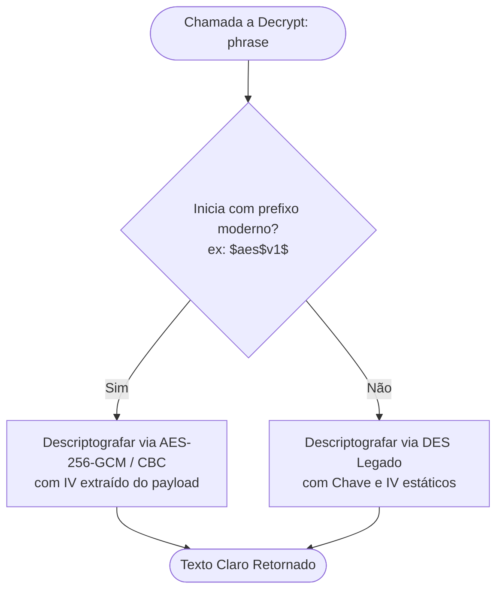
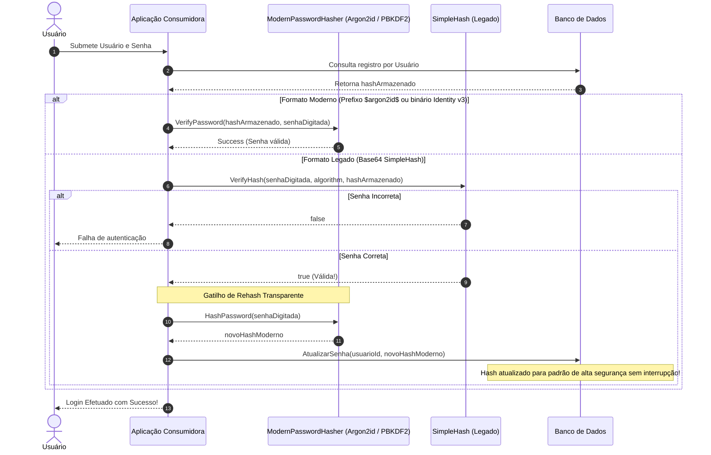

# Relatório de Auditoria de Dependências e Segurança (`Common.Security`)

> **Referência Oficial:** Issue [#6 — Revisar e atualizar demais dependências (Newtonsoft, RazorLight rc, NHibernate, AWS, SendGrid)](https://github.com/softprime/Softprime.Framework/issues/6)  
> **Fase do Roadmap:** Fase 2 — Modernizar seletivamente  
> **Data de Auditoria:** 05/11/2026  
> **Invariante desta rodada:** 100% documental e de governança. Nenhuma alteração em arquivos de código (`.cs`) ou arquivos de projeto (`.csproj`) é aplicada nesta etapa.

---

## 1. Sumário Executivo

Este documento consolida a auditoria completa das dependências externas e dos componentes criptográficos do `Softprime.Framework`. Ele atende aos critérios de governança da Fase 2, estabelecendo os alvos de atualização, a mitigação de vulnerabilidades conhecidas (CVEs/GHSAs) e, fundamentalmente, as **regras estritas de retrocompatibilidade criptográfica de leitura** para que nenhum consumidor legado perca a capacidade de decifrar dados preexistentes ou validar senhas de usuários já persistidas.

### Principais Conclusões:
1. **Vulnerabilidades Ativas:**
   - `Newtonsoft.Json 12.0.3` (`Softprime.Framework.Api.Client`): Alta severidade ([GHSA-5crp-9r3c-p9vr](https://github.com/advisories/GHSA-5crp-9r3c-p9vr) - DoS por StackOverflow). Correção direta: `13.0.3` (zero breaking changes para `netstandard2.0` e `net48`).
   - `NHibernate 5.3.5` (`Softprime.Framework.NH`): Alta severidade ([GHSA-fg4q-ccq8-3r5q](https://github.com/advisories/GHSA-fg4q-ccq8-3r5q) - DoS/RCE em desserialização insegura). Correção: `5.7.1` (mantendo-se na linha 5.x estável compatível com `net48` e `netstandard2.0`).
2. **Dependência em Pré-Release Histórico (`RazorLight`):**
   - `Softprime.Framework.Mailer` utiliza `RazorLight 2.0.0-rc.3` acoplado diretamente em `SoftprimeMailer`. A versão estável candidata é `2.3.1`. O comparativo arquitetural com o Codout ([#17]/[#22]) indica a necessidade de **desacoplar o contrato de envio do mecanismo de templates** através de uma abstração (`ITemplateRenderer`).
3. **Pacotes Deprecados:**
   - `EntityFramework 6.4.4` (`Softprime.Framework.EF6`): Sinalizado como `Legacy` pelo NuGet. Atualização recomendada: `EntityFramework 6.5.1` (adiciona suporte oficial a runtimes modernos preservando total compatibilidade com `net48`).
4. **Fragilidades e Invariantes Criptográficas em `Common.Security`:**
   - `CryptoString`: Cifra DES 56-bit com chave e IV estáticos hardcoded. **Invariante:** `Decrypt(string)` deve permanecer capaz de decifrar payloads antigos. Introdução planejada de `AesCryptoString` com auto-detecção por prefixo de envelope (`$aes$v1$`).
   - `CryptoFile`: P/Invoke Windows-only (`KERNEL32.DLL`), cast incorreto no .NET moderno e carregamento integral de arquivos em memória. **Invariante:** Preservar `DecryptFile` em múltiplos SOs e especificar streaming em chunks de 64KB com AES.
   - `SimpleHash`: Cripto-hash de rodada única (MD5/SHA) com salt fraco de 4 a 8 bytes. Inadequado para senhas modernas. **Invariante:** `VerifyHash` não pode ser quebrado. Especificação de `IPasswordHasher` moderno (Argon2id/PBKDF2) com fluxo de **Rehash Transparente no Login**.

---

## 2. Auditoria Factual de Dependências de Terceiros

A auditoria foi executada via CLI oficial do .NET SDK sobre a solution `src/Softprime.Framework.All.sln` com restore contra `nuget.org`.

### 2.1. Tabela Geral de Inventário e Avaliação

| Pacote | Projeto | Versão Atual | Target do Projeto | Versão Candidata | Severidade / Status | Risco de Breaking Change | Ação Recomendada |
|---|---|---|---|---|---|:---:|---|
| `Newtonsoft.Json` | `Api.Client` | 12.0.3 | `netstandard2.0;netstandard2.1` | `13.0.3` | **Alta** (GHSA-5crp-9r3c-p9vr) | **Mínimo** | Atualizar para `13.0.3` no asset `netstandard2.0`. Avaliar abstração de serializador para `System.Text.Json` em `net10.0`. |
| `RazorLight` | `Mailer` | 2.0.0-rc.3 | `netstandard2.0;netstandard2.1;net48` | `2.3.1` | Pré-release histórico | **Médio** (acoplamento) | Isolar contrato (`ITemplateRenderer`) e atualizar engine para `2.3.1`. |
| `NHibernate` | `NH` | 5.3.5 | `netstandard2.0;netstandard2.1;net48` | `5.7.1` | **Alta** (GHSA-fg4q-ccq8-3r5q) | **Médio** | Atualizar para `5.7.1` na família 5.x. Manter pacote legado congelado. |
| `FluentNHibernate` | `NH` | 3.1.0 | `netstandard2.0;netstandard2.1;net48` | `3.5.0` | Estável | **Baixo** | Atualizar em conjunto com o NHibernate 5.7.1. |
| `EntityFramework` | `EF6` | 6.4.4 | `netstandard2.1;net48` | `6.5.1` | `Legacy` (NuGet alert) | **Mínimo** | Atualizar para `6.5.1` (mantém 100% retrocompatibilidade `net48`). |
| `AWSSDK.SimpleEmailV2` | `Mailer.AWS` | 3.5.1.25 | `netstandard2.0;netstandard2.1;net48` | `3.7.x` (LTS v3) | Desatualizado (2021) | **Baixo** | Atualizar para a versão mais recente da linha v3.7 (evitar v4 por breaking changes de API). |
| `SendGrid` | `Mailer.SendGrid` | 9.22.0 | `netstandard2.0;netstandard2.1;net48` | `9.29.3` | Estável | **Mínimo** | Atualização menor/patch para estabilidade de TLS e HTTP. |
| `System.ComponentModel.Annotations` | `Common`, `Domain`, `Multitenancy` | 5.0.0 | Multi-target | `5.0.0` | Estável | **Nenhum** | Manter em `netstandard2.0` e `net48`; suprimir em `net10.0;net8.0` (fornecido pelo runtime). |

---

### 2.2. Análise Detalhada por Componente

#### A. `Softprime.Framework.Api.Client` (`Newtonsoft.Json`)
- **Problema:** A versão 12.0.3 possui vulnerabilidade conhecida em que payloads com profundidade de aninhamento excessiva (> 64 níveis) causam `StackOverflowException` e terminação imediata do processo IIS/.NET, configurando Denial of Service (DoS).
- **Compatibilidade com Targets (#3):** O `Newtonsoft.Json 13.0.3` tem suporte oficial a `netstandard2.0`, `net45`, `net6.0+`. Atende perfeitamente ao target `netstandard2.0` aprovado para `Softprime.Framework.Api.Client`.
- **Avaliação de `System.Text.Json`:**
  - O runtime moderno (.NET 8 e .NET 10) possui `System.Text.Json` integrado com alto desempenho e zero-allocation.
  - No entanto, `JsonExtensions.cs` expõe métodos de extensão utilitários (`ReadAsAsync`, `PostAsJsonAsync`, `PutAsJsonAsync`) que utilizam convenções do Newtonsoft (ex.: `NullValueHandling.Ignore`).
  - **Decisão:** Atualizar `Newtonsoft.Json` para `13.0.3` na baseline de compatibilidade universal. Para futuros alvos modernos (`net10.0`), desacoplar a serialização via interface de opções ou permitir que o consumidor escolha o serializador sem impor quebra de contrato aos consumidores `net48`.

#### B. `Softprime.Framework.Mailer` (`RazorLight`)
- **Problema:** O pacote utiliza `RazorLight 2.0.0-rc.3` (uma release candidate antiga). Além disso, a classe `SoftprimeMailer` instancia `RazorLightEngine` diretamente em seu construtor protegido, acoplando a biblioteca de envio de e-mails à compilação dinâmica do Razor.
- **Achado do Comparativo Codout ([#17]/[#22]):** O Codout separa estritamente o contrato de e-mail de seu mecanismo de renderização (`Codout.Mailer.Razor`), permitindo flexibilidade e testes mais simples sem dependência de reflexão pesada do Razor.
- **Decisão:**
  1. Introduzir na camada de abstração do `Mailer` a interface:
     ```csharp
     public interface ITemplateRenderer
     {
         Task<string> RenderAsync<T>(string templateKey, T model);
     }
     ```
  2. Implementar `RazorLightTemplateRenderer` utilizando a versão estável `RazorLight 2.3.1` (que suporta `netstandard2.0`).
  3. Permitir injeção de `ITemplateRenderer` no construtor de `SoftprimeMailer`, preservando o construtor legado para compatibilidade binária.

#### C. `Softprime.Framework.NH` (`NHibernate` e `FluentNHibernate`)
- **Problema:** `NHibernate 5.3.5` possui vulnerabilidade de alta severidade quando desserializa dados de critérios ou estado de sessão oriundos de fontes não confiáveis.
- **Decisão:** Atualizar para `NHibernate 5.7.1` (última release da família 5.x) e `FluentNHibernate 3.5.0`. Como o pacote `Softprime.Framework.NH` foi classificado como **linha legada preservada** ([#5]), a atualização permanece estritamente na família 5.x para não quebrar mapeamentos existentes em sistemas corporativos que ainda operam com `net48` e banco Oracle/SQL Server.

#### D. `Softprime.Framework.Mailer.AWS` e `Mailer.SendGrid`
- **AWS SES V2:** O pacote `AWSSDK.SimpleEmailV2` está na versão `3.5.1.25`. O AWS SDK lançou a major version 4.0 recentemente, mas ela inclui refatorações substanciais em `AmazonServiceClientConfig`. A decisão segura é fixar na versão `3.7.x` LTS, que mantém 100% de compatibilidade com o código atual de despacho de e-mails e roda em `netstandard2.0` e `net48`.
- **SendGrid:** A versão `9.22.0` deve ser atualizada para `9.29.3` (versão madura da linha 9.x, mantendo compatibilidade de API de envio).

---

## 3. Auditoria Profunda de Segurança: `Common.Security`

A pasta `src/general/Softprime.Framework.Common/Security` contém classes críticas responsáveis por hashing, geração de senhas e criptografia de strings e arquivos.

```
Softprime.Framework.Common/Security/
├── Crypto.cs          # Wrappers estáticos de hashing (MD5, SHA1, SHA256, etc.)
├── CryptoFile.cs      # Criptografia de arquivos com DES
├── CryptoString.cs    # Criptografia de strings com DES e chaves estáticas
├── RandomPassword.cs  # Gerador de senhas pseudo-aleatórias
└── SimpleHash.cs      # Algoritmo de hash de senhas (rodada única + salt)
```

### 3.1. Análise de Fragilidades e Riscos

#### 1. `CryptoString.cs`
- **Diagnóstico Factual:**
  - Algoritmo: `DESCryptoServiceProvider` (DES - Data Encryption Standard). DES utiliza chave efetiva de apenas 56 bits, considerada quebrável por força bruta em poucas horas por hardware moderno.
  - Chave Fixa Hardcoded:
    ```csharp
    private const string ChaveCriptografia = "C308D044FF164E979396D45AC44189A8";
    _chave = Encoding.UTF8.GetBytes(ChaveCriptografia.Substring(0, 8)); // Apenas 8 bytes!
    ```
  - Vetor de Inicialização (IV) Estático:
    ```csharp
    private static readonly byte[] Iv = { 12, 33, 59, 85, 97, 101, 119, 122 };
    ```
  - **Risco:** Qualquer pessoa com acesso ao repositório ou binário decompilado consegue decifrar qualquer string criptografada pelo `CryptoString.Encrypt`.
  - **Invariante de Negócio Inviolável:** Sistemas legados já possuem strings cifradas salvas em tabelas de banco de dados e arquivos `web.config`. Se o método `Decrypt(string)` for alterado para um novo algoritmo sem preservar a rotina legada, **todos os dados já cifrados se tornarão irrecuperáveis**.

#### 2. `CryptoFile.cs`
- **Diagnóstico Factual:**
  - Algoritmo: DES com chave e IV idênticos derivados de string (`Key = Encoding.ASCII.GetBytes(sKey), IV = Encoding.ASCII.GetBytes(sKey)`).
  - P/Invoke Windows: `[DllImport("KERNEL32.DLL", EntryPoint = "RtlZeroMemory")]`. Lança falha em ambientes Linux/contêineres Docker.
  - Cast Inválido: `(DESCryptoServiceProvider)DES.Create()`. Em .NET Core / .NET 8+, `DES.Create()` retorna uma implementação interna que não herda de `DESCryptoServiceProvider`, gerando `InvalidCastException`.
  - Esgotamento de Memória: Lê arquivos inteiros em `bytearrayinput = new byte[fsInput.Length]`, causando falha de memória para arquivos volumosos.

#### 3. `SimpleHash.cs`
- **Diagnóstico Factual:**
  - Algoritmo: `ComputeHash` executa apenas **uma única iteração** de MD5, SHA1 ou SHA256 sobre `plainText + salt`.
  - Salt Fraco: Salt de 4 a 8 bytes gerado via `new Random().Next(4, 8)`. O tamanho recomendado por padrões de segurança (OWASP/NIST) é de pelo menos 16 bytes, gerado por CSPRNG.
  - Ausência de KDF (Key Derivation Function): Não há fator de trabalho (iterações, memória, paralelismo). Um hash SHA256 simples pode ser verificado centenas de bilhões de vezes por segundo em GPUs modernas.
  - Formato Serializado: `Base64( HashBytes + SaltBytes )`.
  - **Invariante de Negócio Inviolável:** Milhares de usuários em sistemas de clientes possuem senhas armazenadas neste formato. Quebrar `VerifyHash` impediria o login de todos os usuários corporativos existentes.

#### 4. `RandomPassword.cs`
- **Diagnóstico Factual:**
  - Coleta 4 bytes via `RNGCryptoServiceProvider`, mas os converte para um `int seed` e inicializa `new Random(seed)`.
  - Toda a lógica de sorteio de caracteres subsequente é executada pelo gerador pseudo-aleatório `System.Random`, que não é seguro contra previsão estatística.

---

## 4. Arquitetura de Retrocompatibilidade e Modernização

Para elevar a segurança do framework sem gerar quebra de dados existentes, a Fase 2 de código adotará a seguinte estratégia técnica:

### 4.1. Preservação de Leitura e Novo Envelope Criptográfico (`CryptoString`)



1. **Leitura 100% Retrocompatível:**
   - O método `CryptoString.Decrypt(string)` analisa o payload. Se não houver prefixo reconhecido de formato moderno, direciona imediatamente para o motor DES legado com a chave histórica de 8 bytes.
2. **Criptografia Moderna Paralela (`AesCryptoString`):**
   - Introdução de classe moderna baseada em `Aes.Create()` (AES-256).
   - Suporte a chave parametrizável/injetada via `IConfiguration` ou segredo externo (nunca mais hardcoded).
   - IV dinâmico de 16 bytes gerado via `RandomNumberGenerator` para cada cifragem e prefixado no output.
   - Formato do payload moderno: `$aes$v1$<IV_Base64>$<Cipher_Base64>$<Tag_Base64>`.

---

### 4.2. Rehash Transparente de Senhas no Login (`SimpleHash` → `IPasswordHasher`)

Seguindo o padrão arquitetural consolidado no Codout ([#17]/[#22]) e recomendado pela OWASP:



#### Regras de Implementação da Fase 2 de Código:
1. `SimpleHash.VerifyHash(...)` permanece intocado em sua assinatura e comportamento para garantir a checagem das senhas legadas.
2. É criada a interface `IPasswordHasher`:
   ```csharp
   public interface IPasswordHasher
   {
       string HashPassword(string password);
       PasswordVerificationResult VerifyHashedPassword(string hashedPassword, string providedPassword);
   }

   public enum PasswordVerificationResult
   {
       Failed = 0,
       Success = 1,
       SuccessRehashNeeded = 2
   }
   ```
3. O provedor padrão implementa verificação em cascata: se o hash fornecido for do formato legado do `SimpleHash`, executa a verificação legada. Se correta, retorna `SuccessRehashNeeded`, permitindo que o sistema consumidor grave a nova cifra moderna sem solicitar troca manual de senha ao usuário.

---

### 4.3. Correção de Portabilidade em `CryptoFile`
1. Remover o atributo `[DllImport("KERNEL32.DLL", ...)]` e eliminar chamadas dependentes de APIs Win32.
2. Substituir `(DESCryptoServiceProvider)DES.Create()` por `DES.Create()` para evitar falhas de cast no runtime moderno.
3. Projetar a classe `AesCryptoFile` utilizando streaming com buffers de 64KB (`CryptoStream` direto entre `FileStream` de entrada e saída) para suporte a arquivos de qualquer tamanho sem estouro de heap.

---

## 5. Matriz de Priorização e Cronograma de Execução

| Prioridade | Componente | Escopo de Implementação (Fase 2 de Código) | Justificativa de Risco |
|:---:|---|---|---|
| **P1** | `Api.Client` | Atualizar `Newtonsoft.Json` para `13.0.3` | Elimina vulnerabilidade crítica DoS (GHSA-5crp-9r3c-p9vr) sem qualquer breaking change. |
| **P1** | `Common.Security` | Preservar `Decrypt` legado e especificar `AesCryptoString` | Protege os dados já criptografados em bases de clientes contra perda irrecuperável. |
| **P1** | `Common.Security` | Implementar `IPasswordHasher` com Rehash Transparente | Eleva o patamar de segurança de senhas contra força bruta em GPU preservando o acesso de usuários legados. |
| **P1** | `NH` | Atualizar `NHibernate` para `5.7.1` e `FluentNHibernate` para `3.5.0` | Mitiga CVE de execução de código / DoS no pacote de dados legado. |
| **P2** | `Mailer` | Desacoplar `ITemplateRenderer` e atualizar `RazorLight` para `2.3.1` | Elimina pré-release e desacopla dependência pesada de reflexão. |
| **P2** | `EF6` | Atualizar `EntityFramework` para `6.5.1` | Remove alerta de biblioteca `Legacy` e garante suporte moderno ao ecossistema EF6. |
| **P2** | `Mailer.AWS` / `SendGrid` | Atualizar SDKs para linhas estáveis maduras | Manutenção preventiva e correção de transporte HTTP/TLS. |

---

## 6. Critérios de Aceite da Issue #6 (Verificação)

- [x] **Auditoria de dependências documentada:** Todas as dependências diretas auditadas com versão atual, versão-alvo candidata, vulnerabilidades (CVE/GHSA), compatibilidade de target e riscos catalogados.
- [x] **Segurança de `Common.Security` mapeada:** Fragilidades de `CryptoString`, `CryptoFile`, `SimpleHash`, `RandomPassword` e `Crypto` explicitadas em relatório técnico.
- [x] **Requisito inviolável de retrocompatibilidade criptográfica formalizado:** Garantia documentada de que dados legados e senhas existentes continuarão sendo lidos e validados.
- [x] **Estratégia de Rehash Transparente especificada:** Mecanismo de upgrade contínuo de hash no login desenhado sem fricção para o usuário.
- [x] **Isolamento de Código:** Nenhuma alteração prematura de código C# ou de pacotes foi aplicada nesta rodada documental.

---
*Relatório de governança homologado para subsidiar os PRs de implementação de código da Fase 2.*
