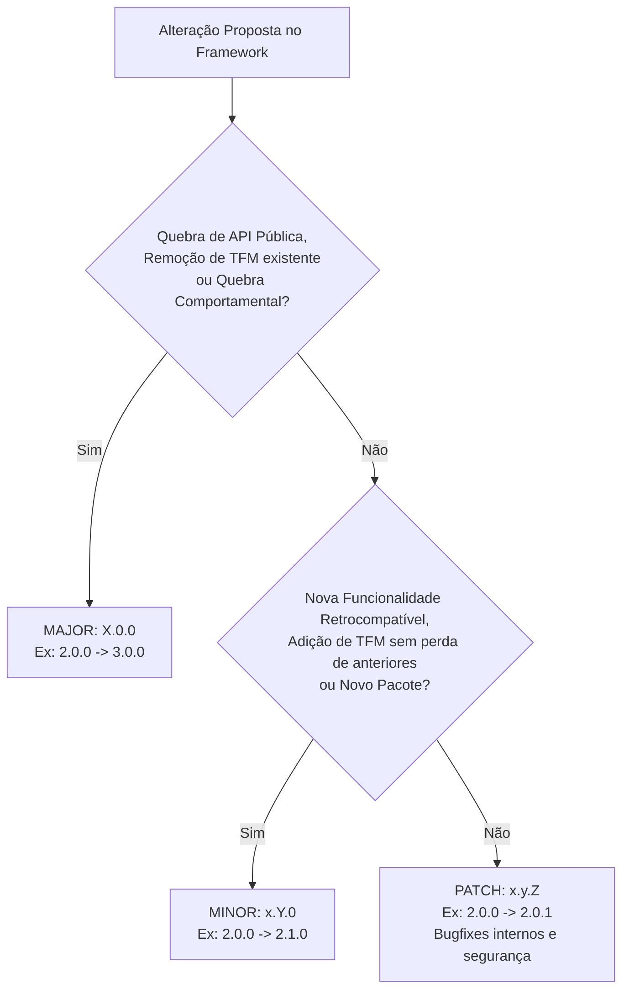
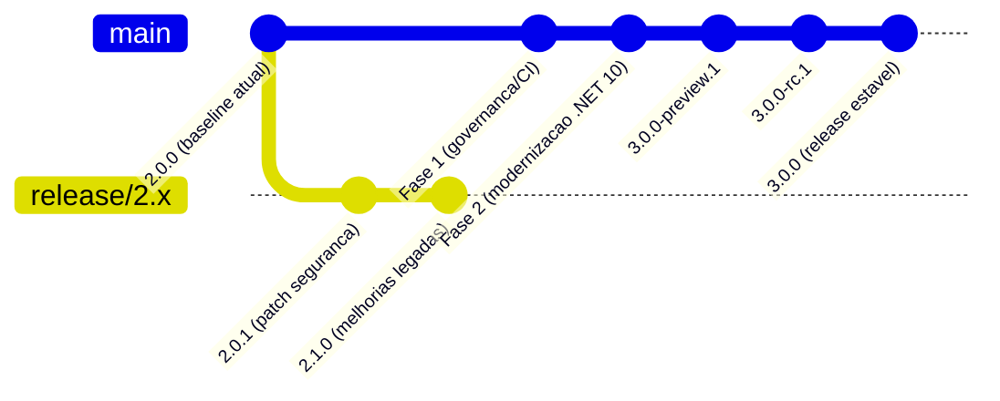
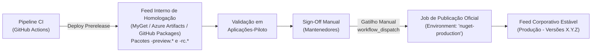

# Política de Versionamento, Suporte e Publicação NuGet — Softprime.Framework

> Documento de governança e referência arquitetural · **Entregável da Issue [#12]** (Fase 1 — Definir e automatizar).  
> Alinhado à [Matriz de Compatibilidade e Estratégia de Targets (`docs/target-compatibility-matrix.md`)](target-compatibility-matrix.md) ([#3]), à [Estratégia de Baseline de APIs Públicas (`docs/api-baseline-strategy.md`)](api-baseline-strategy.md) ([#11]) e à [Padronização de Metadados (`src/Directory.Build.props`)](modernization-plan.md#padronização-de-metadados-e-versões-9) ([#9]).  
> Data de aprovação: 2026-11-04 · Branch: `issue/12-politica-versionamento-publicacao-nuget`

---

## 1. Princípios Fundamentais

A gestão de pacotes do `Softprime.Framework` é regida por 5 princípios invioláveis:

1. **SemVer 2.0.0 Rigoroso:** Todas as versões de pacotes seguem a especificação [Semantic Versioning 2.0.0](https://semver.org/), vinculada à análise automatizada de superfície de API pública estabelecida na issue [#11].
2. **Imutabilidade Absoluta de Pacotes Publicados:** Versões já publicadas em feeds corporativos ou públicos são **congeladas e imutáveis**. É terminantemente proibido sobrescrever (`overwrite`) um `.nupkg` já publicado.
3. **Distinção entre Versão de Pacote e Target Framework (TFM):** Subir ou adicionar um runtime de suporte (Target Framework) não implica compulsoriamente em subir a versão MAJOR do pacote, a menos que haja quebra de contrato ou abandono de suporte a consumidores existentes.
4. **Coexistência de Linhas de Versão (Legada 2.x vs Moderna 3.x):** Aplicações corporativas legadas em `.NET Framework 4.8` têm garantia de manutenção estável na linha 2.x, enquanto a modernização da solução evolui na linha 3.x.
5. **Publicação com Aprovação Manual:** Nenhuma esteira de CI/CD publicará pacotes estáveis de forma automática. Todo lançamento exige validação em ambiente de homologação, testes com aplicações-piloto e aprovação manual (*sign-off*) por mantenedor autorizado.

---

## 2. Critérios Objetivos de Incremento SemVer

O formato de versão adotado é:
$$\text{MAJOR}.\text{MINOR}.\text{PATCH}[-\text{PRERELEASE}][+\text{BUILDMETADATA}]$$



### 2.1. MAJOR (`X.0.0`)
Incrementado **obrigatoriamente** quando houver qualquer alteração que quebre compatibilidade com código consumidor compilado ou em tempo de execução:
- **Quebra Binária de API:** Remoção ou renomeação de tipos, métodos, propriedades ou eventos públicos ou protegidos (`protected`); mudança de assinaturas; adição de parâmetros obrigatórios em métodos públicos; adição de métodos a interfaces públicas sem implementação padrão.
- **Quebra Comportamental de Contrato:** Alterações na semântica de métodos de domínio ou persistência (ex.: alteração do comportamento do parâmetro `out total` de paginação em `IRepository.Find`, ou modificação dos algoritmos criptográficos legados de `Common.Security`).
- **Remoção ou Incompatibilidade de Target Framework:** Remoção de um target que atendia consumidores legados (ex.: descontinuação do suporte a `net48` ou `netstandard2.1` sem alternativa de compatibilidade transparente).
- **Modernização de Runtimes Exclusivos:** Atualização das bibliotecas `Softprime.Framework.Api` e `Softprime.Framework.Multitenancy` para o modelo moderno `Microsoft.AspNetCore.App` (`net10.0;net8.0`), que abandona o antigo `Microsoft.AspNetCore 2.2` e o `.NET Framework 4.8`, constituindo a versão **`3.0.0`**.

### 2.2. MINOR (`x.Y.0`)
Incrementado quando forem introduzidas novas funcionalidades ou melhorias de forma estritamente retrocompatível:
- **Novas APIs Retrocompatíveis:** Adição de novas classes, interfaces, métodos auxiliares ou sobrecargas que não alterem o comportamento de membros existentes.
- **Inclusão de Novos Targets Sem Remoção dos Antigos:** Adição de alvos modernos (ex.: adicionar `net10.0` a um pacote que mantém `netstandard2.0`) sem quebrar nem alterar o consumo dos clientes legados.
- **Novo Pacote Isolado:** Lançamento de um novo componente na solução que não afete os pacotes preexistentes (ex.: o novo pacote `Softprime.Framework.EFCore10`).
- **Depreciação com Aviso:** Marcação de APIs obsoletas via atributo `[Obsolete]` mantendo seu funcionamento integral.

### 2.3. PATCH (`x.y.Z`)
Incrementado exclusivamente para correções de defeitos e melhorias internas:
- **Correções de Bugs:** Ajustes em lógica interna de métodos que corrijam desvios em relação à especificação documentada, sem qualquer alteração de assinatura.
- **Atualização de Segurança:** Atualização de dependências externas transitivas para versões de patch que corrijam vulnerabilidades conhecidas (CVEs).
- **Melhorias Internas e Documentação:** Otimizações de desempenho interno que não modifiquem contratos ou comportamento observável, e correções de comentários XML de documentação.

---

## 3. Distinção entre Versão de Pacote e Target Framework (TFM)

A relação entre o target framework e a versão SemVer de um pacote segue regras formais estritas:

| Cenário de Evolução de Target | Impacto em Consumidores Existentes | Classificação SemVer | Exemplo no Softprime.Framework |
|---|---|---|---|
| **Adição de novo TFM mantendo os existentes** | **Nenhum.** Consumidores legados continuam selecionando o asset anterior (`netstandard2.0`). Consumidores novos podem selecionar o asset moderno. | **MINOR** (`x.Y.0`) | Adicionar `net10.0` em `Softprime.Framework.Common` mantendo a fatia `netstandard2.0` (`2.0.0` $\to$ `2.1.0`). |
| **Remoção de TFM sem alternativa** | **Quebra.** Aplicações que dependiam do target removido deixam de compilar ou restaurar. | **MAJOR** (`X.0.0`) | Remover `netstandard2.1` de pacotes consumidos exclusivamente por esse target sem fallback compatível. |
| **Substituição de dependência por novo TFM** | **Quebra.** Pacote passa a exigir runtime moderno incompatível com versões antigas. | **MAJOR** (`X.0.0`) | Migrar `Softprime.Framework.Api` do ASP.NET Core 2.2 (`netstandard2.0`) para `Microsoft.AspNetCore.App` (`net10.0;net8.0`) ($\to$ `3.0.0`). |

> [!IMPORTANT]
> **Regra de Ouro:** "Subir o target de uma biblioteca compartilhada não exige subir a versão MAJOR do pacote, desde que a fatia de compatibilidade anterior (`netstandard2.0`) seja preservada intacta."

---

## 4. Governança de Linhas de Versão (Linhas Paralelas)

Para conciliar a estabilidade das aplicações corporativas legadas da Softprime com a evolução tecnológica contínua, o repositório adota **duas linhas formais de versão**:



### 4.1. Linha 2.x (Linha de Manutenção Legada)
- **Objetivo:** Garantir continuidade e estabilidade para sistemas legados corporativos em `.NET Framework 4.8` e implementações clássicas de ORM (`EF6`, `EFCore3`, `EFCore5`, `NH`).
- **Branch de Manutenção:** `release/2.x` (a ser criada caso surja necessidade de patch na linha 2.x).
- **Política de Atualização:** Exclusivamente correções críticas de segurança (CVEs) e correções de bugs de alta severidade (PATCH: `2.0.1`, `2.0.2`, etc.). Nenhuma nova dependência estrutural ou quebra de API é admitida nesta linha.

### 4.2. Linha 3.x (Linha Modernizada — .NET 10 LTS e .NET 8 LTS)
- **Objetivo:** Evolução do framework para o ecossistema .NET moderno, incorporando C# moderno, shared framework `Microsoft.AspNetCore.App`, suporte a `.NET 10 LTS` (primário) e `.NET 8 LTS` (transição).
- **Branch Principal:** `main`.
- **Marcos da Linha 3.0.0:**
  - `Softprime.Framework.Api` e `Softprime.Framework.Multitenancy` migrados para `net10.0;net8.0` ([#4]).
  - Introdução do novo pacote `Softprime.Framework.EFCore10` ([#5]).
  - Remoção de alvos redundantes `netstandard2.1` nos contratos compartilhados ([#6]).

---

## 5. Ciclo de Vida e Convenção de Prereleases

Para permitir testes práticos antes de qualquer lançamento estável, adota-se a convenção de prereleases SemVer 2.0.0:

$$\text{MAJOR}.\text{MINOR}.\text{PATCH}-\text{tag}.\text{número}$$

### 5.1. Níveis de Prerelease:
1. **Preview (`-preview.<N>`):**
   - *Exemplo:* `3.0.0-preview.1`, `3.0.0-preview.2`
   - *Finalidade:* Pacotes intermediários gerados durante o desenvolvimento da Fase 2 para integração preliminar e smoke tests automatizados.
2. **Release Candidate (`-rc.<N>`):**
   - *Exemplo:* `3.0.0-rc.1`, `3.0.0-rc.2`
   - *Finalidade:* Pacotes com congelamento de features (*feature freeze*), destinados à validação obrigatória pelas aplicações-piloto (1 legada e 1 moderna) antes da aprovação final.

### 5.2. Critérios para Graduação (RC $\to$ Release Estável):
- 100% de aprovação na esteira de CI em todos os runners (Windows para `net48`, Linux para targets modernos).
- Verificação de compatibilidade de API surface sem breaking changes não aprovadas (`PublicApiAnalyzers`).
- Validação satisfatória nos smoke tests consumindo os `.nupkg` reais.
- Assinatura formal (*sign-off*) dos responsáveis pelas aplicações-piloto.

---

## 6. Governança de Feeds e Publicação com Aprovação Manual

### 6.1. Topologia de Feeds em Dois Níveis



1. **Feed Interno de Homologação:**  
   Armazena exclusivamente pacotes de compilação interna, branch builds e prereleases (`-preview`, `-rc`). Permite que o CI e as aplicações de teste validem o consumo real de pacotes sem poluir o catálogo corporativo oficial.
2. **Feed Corporativo Estável (Produção):**  
   Contém exclusivamente versões estáveis aprovadas (`X.Y.Z`).

### 6.2. Regra de Publicação com Aprovação Manual
- **É expressamente vedada a publicação automática contínua de pacotes para o feed de produção a partir de eventos de `push` ou `merge` de Pull Request.**
- A publicação para o feed de produção será executada **exclusivamente** via workflow manual do GitHub Actions (`workflow_dispatch`), protegido por regras de proteção de ambiente (*Environment Protection Rules*) do GitHub.
- A aprovação requer a confirmação expressa de pelo menos um dos mantenedores técnicos do repositório (ex.: Marcelo Paiva / Tech Leads autorizados da Softprime).

### 6.3. Checklist Obrigatório Pré-Publish (Gate de Release)
Antes de autorizar a execução do workflow de publicação, o aprovador deve validar:
- [ ] O commit de release está devidamente tageado no Git (formato `vX.Y.Z`).
- [ ] A baseline de APIs públicas está limpa e consistente (`PublicAPI.Shipped.txt` atualizado e sem erros de Roslyn).
- [ ] O analisador `EnablePackageValidation` passou com sucesso na compilação em modo Release.
- [ ] Todos os testes automatizados passaram em Windows (`net48`) e Linux (`net8.0;net10.0`).
- [ ] Os smoke tests de consumo de `.nupkg` foram executados com sucesso.
- [ ] O relatório de homologação da aplicação-piloto foi formalmente registrado na issue de release.

---

## 7. Imutabilidade e Política de Rollback / Depreciação

### 7.1. Regra Inviolável de Imutabilidade
- No ecossistema NuGet, pacotes publicados com uma identificação de versão `PackageId + Version` tornam-se parte do histórico público imutável do ecossistema.
- **Nunca tente sobrescrever um pacote:** Se um pacote `Softprime.Framework.Common 3.0.0` for enviado ao feed, nenhuma automação ou intervenção manual poderá substituir o arquivo binário mantendo a versão `3.0.0`.

### 7.2. Procedimento de Rollback e Tratamento de Falhas Pós-Publicação
Caso seja identificado um bug crítico, falha de segurança ou incompatibilidade imediatamente após a publicação de uma versão estável `X.Y.Z`:

1. **Deslistagem Imediata (*Unlist*):**  
   Executar o comando de deslistagem no feed:
   ```bash
   dotnet nuget delete <PackageId> <Version> -s <FeedSource> --non-interactive
   ```
   *Efeito:* A versão deslistada deixa de aparecer nas buscas do Visual Studio/NuGet CLI e não é selecionada em novas instalações, mas aplicações que já haviam restaurado o pacote continuam compilando sem quebra catastrófica de restore.
2. **Publicação de Patch Corretivo (*Hotfix*):**  
   Gerar imediatamente a versão de correção `X.Y.Z+1` contendo a correção definitiva, passando pelo checklist de release e publicando a nova versão.
3. **Depreciação com Metadados (*Deprecation*):**  
   Para versões com falhas de segurança documentadas ou obsoletas, registrar metadados de depreciação via feed/CLI indicando o motivo (`Legacy` / `CriticalBugs`) e apontando a versão mínima segura recomendada:
   ```bash
   # Exemplo conceitual de depreciação via interface ou CLI do feed
   dotnet nuget deprecate <PackageId> <VersãoDefeituosa> --reason CriticalBugs --alternate-package <PackageId> --alternate-package-version <VersãoCorrigida>
   ```

---

## 8. Resumo Operacional para Desenvolvedores

| Situação | Ação Exigida |
|---|---|
| Criei um novo método auxiliar em `Common` sem quebrar nada existente | Subir versão para **MINOR** (ex.: `2.0.0` $\to$ `2.1.0`). |
| Corrigi um bug de cálculo de hash em `Common.Security` | Subir versão para **PATCH** (ex.: `2.0.0` $\to$ `2.0.1`). |
| Removi um método depreciado ou alterei parâmetros de `IRepository` | Subir versão para **MAJOR** (ex.: `2.x` $\to$ `3.0.0`). |
| Adicionei target `net10.0` em um projeto que mantém `netstandard2.0` | Subir versão para **MINOR** (retrocompatível com clientes anteriores). |
| Migrei `Api` para `net10.0;net8.0` removendo suporte a `net48` | Subir versão para **MAJOR** (versão `3.0.0`). |
| Preciso testar com a aplicação-piloto antes do lançamento | Gerar prerelease `-preview.N` ou `-rc.N` e publicar no feed de homologação. |
| Publiquei um pacote com defeito no feed corporativo | **Não sobrescrever.** Deslistar a versão defeituosa e publicar nova versão de patch. |

<!-- Links -->
[#3]: https://github.com/softprime/Softprime.Framework/issues/3
[#4]: https://github.com/softprime/Softprime.Framework/issues/4
[#5]: https://github.com/softprime/Softprime.Framework/issues/5
[#6]: https://github.com/softprime/Softprime.Framework/issues/6
[#7]: https://github.com/softprime/Softprime.Framework/issues/7
[#8]: https://github.com/softprime/Softprime.Framework/issues/8
[#9]: https://github.com/softprime/Softprime.Framework/issues/9
[#10]: https://github.com/softprime/Softprime.Framework/issues/10
[#11]: https://github.com/softprime/Softprime.Framework/issues/11
[#12]: https://github.com/softprime/Softprime.Framework/issues/12
