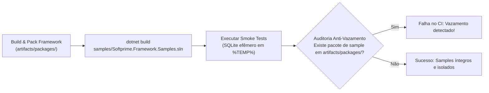

# Padrão Arquitetural de Samples e Contrato Didático (DX) — Softprime.Framework

> **Documento normativo de arquitetura e governança de DX · Entregável da Issue [#18]** (Frente B — Samples e Developer Experience).  
> Pertencente à issue-mãe **[#23]** e alinhado à [Matriz de Compatibilidade e Targets (`docs/target-compatibility-matrix.md`)](target-compatibility-matrix.md) ([#3]), à [Estratégia de Testes (`docs/test-strategy.md`)](test-strategy.md) ([#7]), à [Especificação da Esteira de CI (`docs/ci-pipeline-spec.md`)](ci-pipeline-spec.md) ([#8]), à [Política de Versionamento NuGet (`docs/nuget-versioning-policy.md`)](nuget-versioning-policy.md) ([#12]) e às [Diretrizes de Governança (`CONTRIBUTING.md`)](../CONTRIBUTING.md) ([#13]).  
> Data de aprovação: 2026-11-06 · Branch: `docs/issue-18-padrao-samples-dx`

---

## 1. Contexto e Objetivos

O **Softprime.Framework** é distribuído como uma coleção modular de pacotes NuGet corporativos. Para acelerar a curva de aprendizado das equipes de engenharia e mitigar dúvidas de integração, a **Frente B** institucionaliza uma trilha didática de projetos de exemplo executáveis em `samples/`.

### Princípios Fundamentais de DX:
1. **Consumo Exclusivo por APIs Públicas:** Os samples demonstram exatamente como um desenvolvedor consumidor utiliza as bibliotecas em suas aplicações. É expressamente proibido acessar tipos internos, usar reflexão não documentada ou reimplementar mecânicas que os pacotes já fornecem.
2. **Autonomia e Execução Offline:** Todo sample deve ser 100% autossuficiente e executável imediatamente após clonar o repositório, sem exigir credenciais privadas, infraestrutura em nuvem paga (como AWS SES ou bancos gerenciados) ou serviços rodando previamente.
3. **Garantia Anti-Apodrecimento via CI:** Todo sample é integrado à esteira de CI do GitHub Actions ([#8], [#21]), sendo compilado e exercitado por *smoke tests* automatizados a cada Pull Request.
4. **Isolamento Absoluto do Empacotamento:** Os samples existem exclusivamente para finalidades didáticas e validação. **Nenhum projeto de sample é publicado como pacote NuGet nem empacotado nos `.nupkg` do framework**.

---

## 2. Arquitetura de Pastas e Solution Dedicada

Para evitar que a solução principal de produção (`src/Softprime.Framework.All.sln`) seja sobrecarregada com dependências de console ou web apps dos exemplos, os samples residem em uma solução dedicada e independente.

```
Softprime.Framework/
├── src/                                  # Bibliotecas de produção (Solution: Softprime.Framework.All.sln)
├── tests/                                # Testes de unidade e caracterização (#7)
├── samples/                              # Trilha didática (Solution: Softprime.Framework.Samples.sln)
│   ├── Softprime.Framework.Samples.sln   # Solution isolada exclusiva para compilar e testar samples
│   ├── Directory.Build.props             # IsPackable=false e GeneratePackageOnBuild=false obrigatórios
│   ├── README.md                         # Índice geral, pré-requisitos globais e mapa da trilha
│   ├── 01-Common/                        # Extensões, validação de CPF/CNPJ, helpers e criptografia
│   ├── 02-Domain/                        # Entidades, Value Objects, DomainSignature e lifecycle hooks
│   ├── 03-Data-EFCore/                   # Repositório genérico, UoW, consultas e SQLite local
│   ├── 04-WebApi/                        # Endpoints REST, contratos CRUD (IApi), DTOs e ApiKeyAuth
│   ├── 05-ApiClient/                     # Cliente HTTP tipado, tratamento de exceções e cancelamento
│   ├── 06-Mailer/                        # Templates de e-mail Razor com FakeMailerDispatcher em memória
│   ├── 07-Multitenancy/                  # Resolução por cabeçalho/subdomínio e rejeição de tenant inválido
│   ├── 08-CompleteSample/                # Aplicação corporativa ponta a ponta integrando todos os módulos
│   └── 99-Net48-Consumo/                 # (Opcional) Aplicação legada Windows consumindo netstandard2.0
└── docs/                                 # Documentação normativa e arquitetural
```

### Configuração de Isolamento (`samples/Directory.Build.props`)
Todos os projetos dentro de `samples/` herdam a seguinte política explícita de não-empacotamento:

```xml
<Project>
  <PropertyGroup>
    <!-- Garante que nenhum sample gere .nupkg ou entre no dotnet pack -->
    <IsPackable>false</IsPackable>
    <GeneratePackageOnBuild>false</GeneratePackageOnBuild>
    <TreatWarningsAsErrors>true</TreatWarningsAsErrors>
    <!-- Alvos padronizados para os samples modernos -->
    <Nullable>enable</Nullable>
    <ImplicitUsings>enable</ImplicitUsings>
  </PropertyGroup>
</Project>
```

---

## 3. Matriz de Targets dos Samples

Seguindo a [Matriz de Compatibilidade aprovada na Issue #3](target-compatibility-matrix.md), os samples modernos são configurados em **multi-targeting moderno `net10.0;net8.0`** (ou `net10.0` com suporte direto a execução em .NET 8 LTS), permitindo validação em ambos os runtimes LTS corporativos:

| Sample | Nome do Projeto | Targets | Dependências de Infraestrutura | Mecanismo de Isolamento | Predecessora |
|---|---|---|---|---|---|
| **01-Common** | `Softprime.Samples.Common` | `net10.0;net8.0` | Nenhuma (Console App) | Execução local isolada | [#3] |
| **02-Domain** | `Softprime.Samples.Domain` | `net10.0;net8.0` | Nenhuma (Console App) | In-memory | [#3] |
| **03-Data-EFCore** | `Softprime.Samples.DataEFCore` | `net10.0;net8.0` | SQLite Local (`%TEMP%`) | Banco efêmero descartável | [#3], [#5] |
| **04-WebApi** | `Softprime.Samples.WebApi` | `net10.0;net8.0` | Web API / Kestrel local | In-memory / SQLite | [#3], [#4] |
| **05-ApiClient** | `Softprime.Samples.ApiClient` | `net10.0;net8.0` | Mock HTTP / TestServer | In-memory | [#3] |
| **06-Mailer** | `Softprime.Samples.Mailer` | `net10.0;net8.0` | Nenhuma | `FakeMailerDispatcher` local | [#3], [#6] |
| **07-Multitenancy** | `Softprime.Samples.Multitenancy` | `net10.0;net8.0` | ASP.NET Core TestServer | Headers / In-memory | [#3], [#4] |
| **08-CompleteSample** | `Softprime.Samples.CompleteSample` | `net10.0;net8.0` | SQLite Local (`%TEMP%`) | App corporativa integrada | [#3], [#4], [#5], [#6] |
| **99-Net48-Consumo** | `Softprime.Samples.Net48Consumo` | `net48` | Windows Desktop/Console | Validação de consumo netstandard2.0 | [#3] |

---

## 4. Contrato Didático Canônico (Padrão de README por Sample)

> [!IMPORTANT]
> Cada diretório de sample deve obrigatoriamente conter um arquivo `README.md` estruturado nas 7 seções canônicas a seguir. Essa ordem e nomenclatura são fixas para assegurar uniformidade e previsibilidade em toda a experiência do desenvolvedor (DX).

### Template Canônico de README:

````markdown
# [Número-NomeDoSample] — Softprime.Framework

## 1. O que ensina
Explicação clara e objetiva (1 a 3 parágrafos) do conceito arquitetural demonstrado e quais classes/interfaces do framework são exercitadas.

## 2. Pré-requisitos
- .NET SDK (8.0 LTS ou 10.0 LTS).
- Sistema Operacional suportado (Windows / Linux / macOS).
- Pacotes do framework necessários e versões de referência.

## 3. Comandos de execução
Instruções diretas para restaurar, compilar e rodar a aplicação:

**No Windows (PowerShell):**
```powershell
dotnet run --project samples/01-Common/Softprime.Samples.Common.csproj
```

**No Linux / macOS (Bash):**
```bash
dotnet run --project samples/01-Common/Softprime.Samples.Common.csproj
```

## 4. Fluxo de execução passo a passo
Roteiro explicativo do que a aplicação faz durante a execução:
1. Inicialização do host e injeção de dependências.
2. Criação de entidades e validação de invariantes.
3. Execução da operação de negócio demonstrada.
4. Liberação de recursos e encerramento seguro.

## 5. Saída esperada no console
Exemplo visual exato do output produzido pela aplicação no terminal, permitindo ao usuário checar o sucesso visual imediato.

```text
[11:00:00 INF] Inicializando Softprime.Samples.Common...
[11:00:01 INF] Validando CPF com CpfCnpjAttribute: Válido (True)
[11:00:02 INF] Criptografia CryptoString: CipherText=$AES$v1$... Decrypt=Sucesso!
[11:00:03 INF] Exemplo concluído com sucesso (Exit Code: 0).
```

## 6. Smoke test e validação automatizada
Explicação de como o exemplo é validado de forma não interativa (ex.: passagem de flag `--smoke-test` ou projeto de teste associado com asserções de retorno e validação no CI).

```powershell
dotnet run --project samples/01-Common/Softprime.Samples.Common.csproj -- --smoke-test
```

## 7. Troubleshooting e erros comuns
Tabela ou lista com falhas comuns de ambiente (ex.: porta ocupada, banco de dados bloqueado, target não instalado) e a respectiva solução imediata.
````

---

## 5. Regras de Referência a Pacotes e Consumo Real

Para equilibrar a facilidade de desenvolvimento no monorepo com a garantia de que os pacotes publicados funcionam no mundo real, a Frente B adota uma estratégia em duas camadas:

### 5.1. Camada de Desenvolvimento Local (`ProjectReference`)
Durante o desenvolvimento local no repositório, os samples referenciam os projetos em `src/` via `ProjectReference` condicional para feedback imediato e navegação direta no código:

```xml
<ItemGroup Condition="'$(UseInstalledPackages)' != 'true'">
  <ProjectReference Include="..\..\src\general\Softprime.Framework.Common\Softprime.Framework.Common.csproj" />
</ItemGroup>
```

### 5.2. Camada de Validação no CI e Consumo Real (`PackageReference`)
Na esteira de integração contínua (CI) e em testes formais de consumo de pacotes ([#21]), os samples são validados consumindo os arquivos `.nupkg` reais gerados na compilação em `artifacts/packages/`:
- O comando `dotnet pack src/Softprime.Framework.All.sln -c Release --output artifacts/packages/` produz os pacotes locais.
- Os samples executam `dotnet build samples/Softprime.Framework.Samples.sln --source artifacts/packages/ -p:UseInstalledPackages=true`, garantindo que os metadados do pacote, referências transitivas e empacotamento estão 100% íntegros.

---

## 6. Padrões de Seed e Execução Offline

1. **Dados Determinísticos e Idempotentes:**
   - Carga inicial de dados (*seed data*) utiliza massas padronizadas (ex.: Empresa A/B, Usuário Admin/Operador, Produtos Padrão), sem IDs gerados aleatoriamente que impeçam asserções determinísticas.
2. **Banco de Dados Local e Efêmero (SQLite):**
   - Os samples de persistência (`03-Data-EFCore` e `08-CompleteSample`) operam exclusivamente com **SQLite em arquivo temporário** na pasta temporária do sistema (`%TEMP%` no Windows ou `/tmp` no Linux).
   - O arquivo de banco é gerado com identificador dinâmico:
     ```powershell
     $tempDb = "$env:TEMP\sample_smoke_$([Guid]::NewGuid()).db"
     ```
   - O código do sample e os scripts de teste excluem o banco no bloco `finally`, garantindo ambiente 100% limpo a cada execução.
3. **Serviços Simulados (Mock / Fake):**
   - **Envio de e-mails (`06-Mailer`):** Utiliza um `FakeMailerDispatcher` que implementa `ISoftprimeMailerDispatcher`, gravando os e-mails disparados em memória ou imprimindo no console, sem qualquer chamada de rede externa ou cobrança de serviços.

---

## 7. Integração Contínua e Smoke Tests ([#8], [#21])

A especificação da esteira de CI em [`docs/ci-pipeline-spec.md`](ci-pipeline-spec.md) define um job obrigatório no GitHub Actions para validação contínua dos samples:



### Regras do Gate de CI:
1. **Compilação sem Avisos:** A solution `samples/Softprime.Framework.Samples.sln` deve compilar em modo `Release` com `0 erros` e `0 warnings`.
2. **Verificação de Exit Code:** Cada sample executado com flag `--smoke-test` deve retornar código de saída `0`.
3. **Auditoria de Vazamento no Pack:** O CI audita o diretório `artifacts/packages/` e quebra o build se qualquer pacote com sufixo `.Samples` for detectado.

---

## 8. Sub-issues e Rastreabilidade (Frente B)

A governança e entrega dos samples estão divididas entre as sub-issues coordenadas por **[#23]**:

| Issue | Escopo / Papel | Status |
|---|---|---|
| **[#18]** | **[DX] Definir padrão de samples e documentação** | **Aprovado / Entregue (`docs/samples-design.md`)** |
| **[#19]** | [Samples] Exemplos isolados por componente (01–07) | Desbloqueada por #18 (Aguardando implementação) |
| **[#20]** | [Samples] Aplicação demonstrativa integrada (08-CompleteSample) | Aguarda conclusão dos isolados (#19) |
| **[#21]** | [CI] Compilar e executar smoke tests dos samples | Especificada em #8, desbloqueada para automação |

---

[#3]: https://github.com/softprime/Softprime.Framework/issues/3
[#4]: https://github.com/softprime/Softprime.Framework/issues/4
[#5]: https://github.com/softprime/Softprime.Framework/issues/5
[#6]: https://github.com/softprime/Softprime.Framework/issues/6
[#7]: https://github.com/softprime/Softprime.Framework/issues/7
[#8]: https://github.com/softprime/Softprime.Framework/issues/8
[#12]: https://github.com/softprime/Softprime.Framework/issues/12
[#13]: https://github.com/softprime/Softprime.Framework/issues/13
[#18]: https://github.com/softprime/Softprime.Framework/issues/18
[#19]: https://github.com/softprime/Softprime.Framework/issues/19
[#20]: https://github.com/softprime/Softprime.Framework/issues/20
[#21]: https://github.com/softprime/Softprime.Framework/issues/21
[#23]: https://github.com/softprime/Softprime.Framework/issues/23
