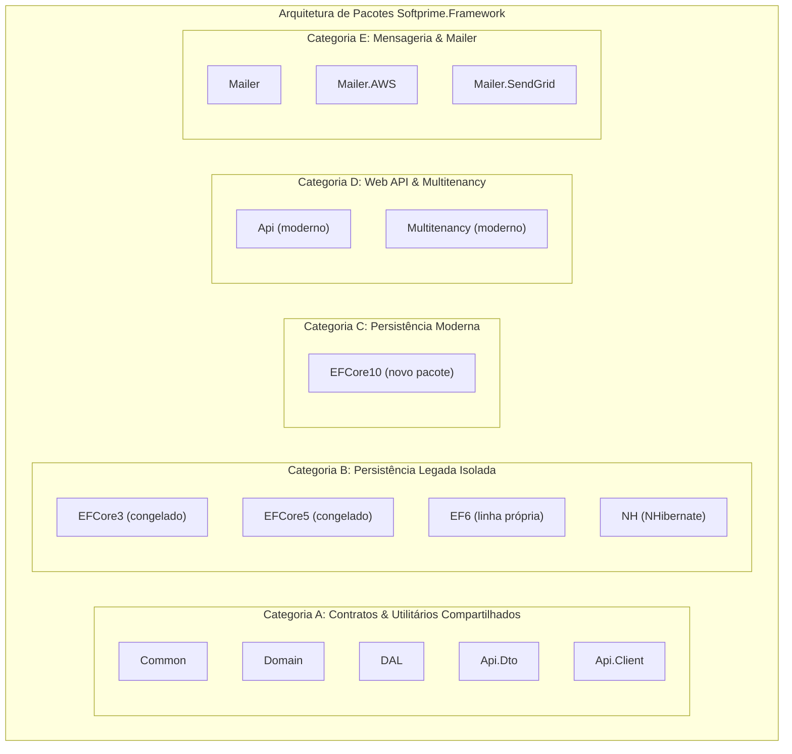

# Matriz de Compatibilidade e Estratégia de Targets — Softprime.Framework

> Documento de referência arquitetural · **Entregável da Issue [#3]** (Fase 1 — Definir e automatizar).  
> Baseado nos achados do [Inventário de Consumidores e Dependências (`docs/package-inventory.md`)](package-inventory.md) ([#10]) e da [Estratégia de Baseline de APIs Públicas (`docs/api-baseline-strategy.md`)](api-baseline-strategy.md) ([#11]).  
> Data de aprovação: 2026-11-04 · Branch: `issue/3-matriz-compatibilidade-targets`

---

## 1. Contexto e Invariantes Fundamentais

A modernização do `Softprime.Framework` precisa atender com segurança a três perfis distintos de consumidores corporativos:

1. **Aplicações Legadas Corporativas (.NET Framework 4.8 — `net48`):**  
   Sistemas estáveis de missão crítica em produção na Softprime, com ciclo de vida atrelado ao suporte do Windows. Não podem sofrer quebras de contrato ou incompatibilidade de runtime nos pacotes de uso comum.
2. **Aplicações Modernas em Produção (.NET 8.0 LTS — `net8.0`):**  
   Aplicações corporativas já migradas para o ecossistema .NET moderno. O .NET 8 é uma versão LTS com suporte ativo até **10 de novembro de 2026**. Pacotes modernizados não podem obrigar essas aplicações a um upgrade compulsório para o .NET 10.
3. **Novos Desenvolvimentos e Alvo de Modernização (.NET 10.0 LTS — `net10.0`):**  
   Alvo moderno de referência para implementações novas (GA em 11 de novembro de 2025, com suporte até **10 de novembro de 2028**). Oferece ganhos de performance (`Span<T>`, novos tipos criptográficos, otimizações de runtime, C# moderno) e acesso ao shared framework `Microsoft.AspNetCore.App`.

### Invariantes Técnicos (Fatos Invioláveis)

- **`.NET Standard 2.1` NÃO roda em `.NET Framework 4.8`:**  
  Qualquer pacote que precise servir consumidores `net48` deve fornecer uma fatia compilada para `.NET Standard 2.0` (`netstandard2.0`) ou um target nativo `.NET Framework 4.8` (`net48`).
- **Resolução de Assets pelo NuGet:**  
  - Um consumidor `net48` consome a fatia nativa `net48` (se existir) ou realiza fallback para `netstandard2.0`.  
  - Um consumidor `net8.0` consome a fatia nativa `net8.0` (se existir); caso o pacote possua apenas `netstandard2.0;net10.0`, o consumidor `net8.0` **não** pode escolher `net10.0` e cai com segurança no asset `netstandard2.0`.  
  - Um consumidor `net10.0` consome a fatia nativa `net10.0` (se existir) ou cai em `net8.0` / `netstandard2.0`.
- **Shared Framework `Microsoft.AspNetCore.App`:**  
  No .NET moderno (8 e 10), o ASP.NET Core não é distribuído como pacotes NuGet isolados (como o antigo `Microsoft.AspNetCore 2.2.0`), mas como um framework compartilhado embutido no SDK. Esse framework é referenciável **apenas** a partir de `net8.0` / `net10.0`. É tecnicamente impossível referenciar `Microsoft.AspNetCore.App` a partir de `netstandard2.0` ou `net48`.
- **Independência de Linhas de Persistência:**  
  `EF6` (EntityFramework 6.4.4 clássico) e `EF Core` são produtos e ecossistemas distintos. Implementações legadas (`EF6`, `EFCore3`, `EFCore5`, `NH`) possuem públicos específicos e não devem ser forçadas a migrações artificiais.

---

## 2. Princípios e Regras Formais de Multi-Targeting

O multi-targeting (`<TargetFrameworks>...</TargetFrameworks>`) aumenta a superfície de compilação, o tempo de build e a matriz de testes. Portanto, deve ser empregado **estritamente sob justificativa registrada**.

### Quando o Multi-Targeting É Justificado:

1. **Diferenciação de Runtimes / Shared Frameworks:**  
   Quando uma biblioteca requer referências que só existem em plataformas modernas (como `<FrameworkReference Include="Microsoft.AspNetCore.App" />`), enquanto componentes legados exigem APIs de desktop/Framework clássico.
2. **Suporte à Janela de Transição LTS (.NET 8 vs .NET 10):**  
   Para bibliotecas de implementação moderna que não podem ser `netstandard2.0` (ex.: `Api`, `Multitenancy` e `EFCore10`), adota-se o multi-targeting **`net10.0;net8.0`** para garantir adoção gradual por consumidores corporativos em produção.
3. **Otimizações de Performance e APIs Modernas em Bibliotecas Compartilhadas:**  
   Quando uma biblioteca de contrato/utilitário (ex.: `Common`) puder se beneficiar de APIs nativas de alta performance do .NET 10 (`Span`, `Memory`, `FrozenDictionary`, novos algoritmos criptográficos em `System.Security.Cryptography`) sem abrir mão da fatia universal `netstandard2.0` para o ecossistema legado.
4. **Preservação de Target Nativo `net48` Existente:**  
   Projetos que já declaram `net48` explicitamente nos `.csproj` (`Domain`, `DAL`, `EF6`, `NH`, `Mailer`) mantêm essa fatia para evitar que consumidores legados em .NET Framework sofram atrito com assemblies de fachada (*facade assemblies*) e *binding redirects*.

### Quando o Multi-Targeting É Proibido / Anti-Pattern:

1. **Multi-Targeting Redundante com `.NET Standard 2.1`:**  
   Declarar `netstandard2.0;netstandard2.1` quando o pacote não utiliza nenhuma API específica do .NET Standard 2.1. O target `netstandard2.1` não atende `net48` e é desnecessário para consumidores modernos que já rodam `netstandard2.0` ou `net10.0`.
2. **Multi-Targeting Cosmético:**  
   Adicionar múltiplos targets (`net8.0;net9.0;net10.0`) sem que haja código condicional (`#if`) ou dependências diferenciadas entre eles, exceto quando necessário para frameworks compartilhados.
3. **Forçar Modernização em Pacote Legado Congelado:**  
   Adicionar `net10.0` a pacotes cujo design e dependências pertencem a ecossistemas congelados (ex.: `EFCore3` e `EFCore5`).

---

## 3. Classificação Arquitetural dos Pacotes

Os 14 pacotes existentes na solution (e o novo pacote planejado `EFCore10`) são categorizados em 5 perfis arquiteturais:

### Categoria A: Contratos e Utilitários Compartilhados
- **Objetivo:** Fornecer interfaces de domínio, persistência, contratos de dados e utilitários universais.
- **Estratégia:** Alvo primário universal **`netstandard2.0`**, preservando o target nativo **`net48`** onde já existente. Na modernização da Fase 2, avaliar inclusão de **`net10.0`** apenas se justificado por otimizações de performance. Descontinuar `netstandard2.1`.
- **Garantia:** Zero quebra para aplicações corporativas em `net48`.

### Categoria B: Implementações Legadas de Persistência
- **Objetivo:** Atender aplicações existentes vinculadas a tecnologias de acesso a dados anteriores.
- **Estratégia:** Preservar pacotes em suas linhas originais e isoladas:
  - `EF6`: Manter `netstandard2.1;net48` (atende legados .NET Framework e migrações preliminares).
  - `EFCore3`: Manter `netstandard2.0;net48` (última versão de EF Core compatível com .NET Framework).
  - `EFCore5`: Manter `netstandard2.1` (congelado na versão 2.0.0).
  - `NH`: Manter `netstandard2.0;net48` (suporte a mapeamentos NHibernate legados).
- **Garantia:** Não forçar quebras estruturais nem fusões com EF Core moderno.

### Categoria C: Implementação Moderna de Persistência
- **Objetivo:** Implementação de repositório e Unit of Work sobre a versão moderna de suporte a longo prazo do Entity Framework Core.
- **Estratégia:** Criação de um novo pacote: **`Softprime.Framework.EFCore10`** com target **`net10.0;net8.0`**.
- **Garantia:** Atende aplicações modernas em .NET 10 LTS e .NET 8 LTS sem contaminar as linhas legadas. Não atende `net48`.

### Categoria D: Web API e Multitenancy
- **Objetivo:** Infraestrutura de controllers, filtros e resolução de tenants HTTP.
- **Estratégia:** Migração na Fase 2 ([#4]) para o shared framework moderno (`Microsoft.AspNetCore.App`), adotando target **`net10.0;net8.0`**.
- **Garantia:** Desacoplamento definitivo do descontinuado `Microsoft.AspNetCore 2.2.0`. Consumidores legados em `net48` permanecem na linha `2.0.0` ou utilizam abstrações puras.

### Categoria E: Mensageria e Envio de E-mails
- **Objetivo:** Disparo de mensagens e templates de e-mail via provedores externos (AWS SES, SendGrid).
- **Estratégia:** Manter suporte a **`netstandard2.0;net48`** para despacho e abstrações. Na Fase 2 ([#6]), planejar a segregação da engine de templates Razor (atualmente `RazorLight 2.0.0-rc.3` instável) em relação aos contratos de despacho.

---

## 4. Matriz Completa de Targets por Pacote

A tabela abaixo define formalmente o papel arquitetural, os alvos atuais, os alvos aprovados para modernização e a justificativa técnica registrada para cada um dos pacotes da solução:

| Pacote (`PackageId`) | Categoria | Targets Atuais | Targets Aprovados (Alvo) | Suporte `net48` | Suporte `net8.0` | Adoção .NET 10 | Destino `netstandard2.1` | Justificativa Técnica Registrada |
|---|---|---|---|---|---|---|---|---|
| `Softprime.Framework.Common` | A (Utilitário) | `netstandard2.0;netstandard2.1` | `netstandard2.0` *(+ `net10.0` se justificado em #6)* | Sim (via `netstandard2.0`) | Sim (via `netstandard2.0`) | Alvo secundário sob demanda de otimização | **Remover na Fase 2** | `netstandard2.0` atende universalmente `net48`, `net8.0` e `net10.0`. `netstandard2.1` é redundante. Target `net10.0` será considerado na Fase 2 para otimizações de `Span` e novos algoritmos em `Common.Security`. |
| `Softprime.Framework.Domain` | A (Contrato) | `netstandard2.0;netstandard2.1;net48` | `netstandard2.0;net48` | Sim (nativo `net48` + `netstandard2.0`) | Sim (via `netstandard2.0`) | Transparente via `netstandard2.0` | **Remover na Fase 2** | Preserva o target nativo `net48` para máxima compatibilidade sem facade assemblies em legados. `netstandard2.0` atende todo o restante. `netstandard2.1` é desnecessário. |
| `Softprime.Framework.DAL` | A (Contrato) | `netstandard2.0;netstandard2.1;net48` | `netstandard2.0;net48` | Sim (nativo `net48` + `netstandard2.0`) | Sim (via `netstandard2.0`) | Transparente via `netstandard2.0` | **Remover na Fase 2** | Contrato base de persistência (`IRepository<T>`, `IUnitOfWork`). Preservação de `net48` e `netstandard2.0` garante estabilidade para todos os ORMs. |
| `Softprime.Framework.Api.Dto` | A (Contrato) | `netstandard2.0;netstandard2.1` | `netstandard2.0` | Sim (via `netstandard2.0`) | Sim (via `netstandard2.0`) | Transparente via `netstandard2.0` | **Remover na Fase 2** | DTOs e contratos de transferência puros sem dependências externas. `netstandard2.0` atende com perfeição qualquer consumidor. |
| `Softprime.Framework.Api.Client` | A (Cliente) | `netstandard2.0;netstandard2.1` | `netstandard2.0` *(+ `net10.0` na Fase 2)* | Sim (via `netstandard2.0`) | Sim (via `netstandard2.0`) | Alvo na modernização com `System.Text.Json` | **Remover na Fase 2** | Atualmente depende de `Newtonsoft.Json 12.0.3`. A fatia `netstandard2.0` mantém o cliente consumível por legados. Na Fase 2, avaliar fatia moderna `net10.0` usando `IHttpClientFactory` e `System.Text.Json`. |
| `Softprime.Framework.EF6` | B (Persistência) | `netstandard2.1;net48` | `netstandard2.1;net48` | Sim (nativo `net48`) | Sim (via `netstandard2.1`) | Não se aplica | **Manter** (linha legada) | Implementação sobre Entity Framework 6.4.4. `net48` atende legados .NET Framework. `netstandard2.1` permite uso em migrações .NET Core/.NET 8. Nenhuma alteração de targets na Fase 2. |
| `Softprime.Framework.EFCore3` | B (Persistência) | `netstandard2.0;netstandard2.1;net48` | `netstandard2.0;net48` | Sim (nativo e standard) | Sim (via standard) | Não se aplica | **Remover na Fase 2** | Linha legada baseada no EF Core 3.1.11. Congelada. Preserva `netstandard2.0;net48` para suporte a aplicações antigas que dependem dessa versão. |
| `Softprime.Framework.EFCore5` | B (Persistência) | `netstandard2.1` | `netstandard2.1` | **Não atende** (nunca suportou) | Sim (via `netstandard2.1`) | Não se aplica | **Manter** (linha legada) | Linha legada baseada no EF Core 5.0.2. Incompatível por natureza com `net48`. Permanece congelada na versão `2.0.0`. Consumidores modernos migrarão para `EFCore10`. |
| `Softprime.Framework.NH` | B (Persistência) | `netstandard2.0;netstandard2.1;net48` | `netstandard2.0;net48` | Sim (nativo `net48` + standard) | Sim (via `netstandard2.0`) | Não planejado (avaliar em #5) | **Remover na Fase 2** | Linha de persistência baseada em NHibernate 5.3.5 / FluentNHibernate 3.1.0. Preserva estabilidade legada. `netstandard2.1` removido por redundância. |
| `Softprime.Framework.EFCore10` | C (Moderna) | *(novo pacote)* | **`net10.0;net8.0`** | **Não atende** (incompatível com .NET Framework) | **Sim (nativo `net8.0`)** | **Sim (nativo `net10.0`)** | Não se aplica | Novo pacote a ser implementado na Fase 2 ([#5]) com EF Core 10 LTS. O multi-targeting com `net8.0` garante cobertura completa da janela de transição corporativa. |
| `Softprime.Framework.Api` | D (Web API) | `netstandard2.0;netstandard2.1` | **`net10.0;net8.0`** | **Não atende** (ASP.NET Core moderno incompatível com `net48`) | **Sim (nativo `net8.0`)** | **Sim (nativo `net10.0`)** | **Remover na Fase 2** | Migração do obsoleto `Microsoft.AspNetCore.Mvc 2.2.0` para o framework nativo `Microsoft.AspNetCore.App` ([#4]). Multi-target `net10.0;net8.0` atende aplicações web modernas. Legados em `net48` permanecem na 2.0.0. |
| `Softprime.Framework.Multitenancy` | D (Web API) | `netstandard2.0;netstandard2.1;net48` | **`net10.0;net8.0`** | **Não atende** (middleware moderno requer `Microsoft.AspNetCore.App`) | **Sim (nativo `net8.0`)** | **Sim (nativo `net10.0`)** | **Remover na Fase 2** | Desacoplamento do ASP.NET Core 2.2 legado ([#4]). Resolução moderna de tenant via pipeline HTTP moderno. Consumidores legados `net48` utilizam versão 2.0.0 ou contratos neutros. |
| `Softprime.Framework.Mailer` | E (Mensageria) | `netstandard2.0;netstandard2.1;net48` | `netstandard2.0;net48` | Sim (nativo `net48` + standard) | Sim (via standard) | Avaliar em #6 (ex: Mailer.Razor moderno) | **Remover na Fase 2** | Mantém contratos de e-mail estáveis para legados. Na Fase 2 ([#6]), isolar o renderizador `RazorLight rc` para que novos consumidores possam adotar renderizadores modernos sem quebrar o core. |
| `Softprime.Framework.Mailer.AWS` | E (Mensageria) | `netstandard2.0;netstandard2.1;net48` | `netstandard2.0;net48` | Sim (nativo `net48` + standard) | Sim (via standard) | Transparente via SDK AWS | **Remover na Fase 2** | Sender AWS SES. O SDK `AWSSDK.SimpleEmailV2` suporta amplamente `net48` e `netstandard2.0`. Eliminação de `netstandard2.1` por redundância. |
| `Softprime.Framework.Mailer.SendGrid` | E (Mensageria) | `netstandard2.0;netstandard2.1;net48` | `netstandard2.0;net48` | Sim (nativo `net48` + standard) | Sim (via standard) | Transparente via SDK SendGrid | **Remover na Fase 2** | Sender SendGrid. O pacote oficial `SendGrid` opera perfeitamente sobre `netstandard2.0` e `net48`. Eliminação de `netstandard2.1` por redundância. |

---

## 5. Diretrizes de Empacotamento, Validação e CI

A concretização desta estratégia de targets na Fase 1 e Fase 2 segue as seguintes diretrizes:

1. **Validação de Pacotes via `EnablePackageValidation` ([#11], [#8]):**  
   Ao gerar os pacotes `.nupkg`, o compilador do SDK .NET validará automaticamente a compatibilidade das diferentes fatias de multi-target, garantindo que membros públicos presentes na fatia `netstandard2.0` tenham paridade semântica com as fatias `net8.0`, `net10.0` ou `net48`.
2. **Ambiente de Build e Testes em CI ([#8]):**  
   - Pacotes com fatias `net48` exigem runners **Windows** (`windows-latest`) nas GitHub Actions.  
   - Fatias modernas (`net8.0`, `net10.0`) e `netstandard2.0` podem ser compiladas e testadas de forma rápida e econômica em runners Linux e Windows.
3. **Smoke Tests por Target ([#7], [#11]):**  
   Os projetos de smoke test consumirão os `.nupkg` reais gerados pelo build, validando a seleção correta de assets:
   - `SmokeTests.Net48` (executa sob runtime .NET Framework 4.8).
   - `SmokeTests.Net8` (executa sob runtime .NET 8.0).
   - `SmokeTests.Net10` (executa sob runtime .NET 10.0).

---

## 6. Próximos Passos e Relação com o Backlog

Esta especificação conclui o planejamento da **Issue [#3]**. A execução prática dos ajustes de target ocorrerá dentro do escopo das respectivas issues da Fase 2:

- **Issue [#4]:** Modernização de `Api` e `Multitenancy` para `net10.0;net8.0` com `Microsoft.AspNetCore.App`.
- **Issue [#5]:** Isolamento de `EF6`, `EFCore3`, `EFCore5`, `NH` e criação do novo pacote `Softprime.Framework.EFCore10` (`net10.0;net8.0`).
- **Issue [#6]:** Atualização de dependências de `Common`, `Api.Client` e `Mailer`, implementando a remoção de `netstandard2.1` dos contratos compartilhados.
- **Issue [#12]:** Definição da política de versionamento SemVer e suporte a linhas de pacotes legadas vs. modernas.

<!-- Links -->
[#3]: https://github.com/softprime/Softprime.Framework/issues/3
[#4]: https://github.com/softprime/Softprime.Framework/issues/4
[#5]: https://github.com/softprime/Softprime.Framework/issues/5
[#6]: https://github.com/softprime/Softprime.Framework/issues/6
[#7]: https://github.com/softprime/Softprime.Framework/issues/7
[#8]: https://github.com/softprime/Softprime.Framework/issues/8
[#10]: https://github.com/softprime/Softprime.Framework/issues/10
[#11]: https://github.com/softprime/Softprime.Framework/issues/11
[#12]: https://github.com/softprime/Softprime.Framework/issues/12
