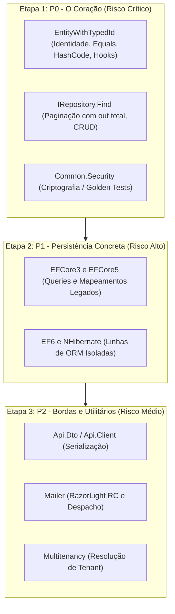

# Estratégia de Testes e Caracterização — Softprime.Framework

> Documento de apoio ao [Plano de Modernização](modernization-plan.md) · **Entregável da Issue [#7]** (Fase 0 — Conhecer e proteger).
>
> Data de elaboração: 2026-11-03 · Branch: `issue/7-estrategia-projetos-testes` · Base: `issue/10-inventario-consumidores-dependencias`

---

## 1. Contexto e Objetivo

A auditoria factual confirmou que a solution `src/Softprime.Framework.All.sln` **não possui nenhum projeto de teste automatizado** (nenhum `.csproj` referencia bibliotecas de teste). Sem uma rede de proteção, qualquer migração de target (.NET 10) ou atualização de dependências acarreta alto risco de regressão silenciosa em produção.

O objetivo deste documento é **definir a estratégia completa de testes de caracterização** que fixará o comportamento atual antes de qualquer alteração de código ou migração de infraestrutura.

> [!IMPORTANT]
> **Natureza de Planejamento (Fase 0):** Este documento estabelece a especificação técnica e a ordem de prioridades. Em estrita conformidade com os critérios de aceite da Fase 0, **nenhum código de teste, arquivo `.csproj` ou alteração na solution é implementado nesta rodada**, e **nenhuma cobertura de testes é declarada atingida**. A criação efetiva dos projetos ocorrerá no início da modernização.

---

## 2. Frameworks e Ferramentas Escolhidos

A suíte de testes do `Softprime.Framework` será padronizada com a seguinte stack:

| Papel | Ferramenta Escolhida | Justificativa Técnica |
|---|---|---|
| **Framework de testes** | `xUnit` | Usar uma versão compatível com os runtimes de cada projeto; fixar versões do framework, runner e `Microsoft.NET.Test.Sdk` na implementação. |
| **Asserções** | `Fluent Assertions 7.x` | Decisão validada: asserções expressivas e mensagens de falha detalhadas. Fixar uma versão exata da linha 7 na implementação, verificando compatibilidade com `net48` e `net10.0`; não atualizar automaticamente para outra major. |
| **Mocking / Fakes** | `Moq 4.x` como padrão para mocks; fakes manuais quando mais simples | Decisão aprovada: isolar dependências externas por interfaces. Fixar a versão exata na implementação. Não usar mocks de `IRepository<T>` para alegar validação das implementações dos ORMs. |
| **Persistência de Testes** | SQL Server e Oracle, conforme consumidores | Bancos informados pelo solicitante como usados habitualmente. Confirmar combinações de ORM, provider, versão do banco e runtime no inventário; não presumir suporte de todos os ORMs aos dois bancos. SQLite pode ser complementar, sem substituir a validação no banco usado pelo consumidor. |

Versões exatas e restauração/execução nos runtimes previstos serão verificadas no primeiro trabalho de implementação. Esta escolha de stack não declara compatibilidade já executada. Não substituir testes relacionais por coleções em memória para validar tradução SQL, transações ou constraints.

**Convenção aprovada: Arrange, Act, Assert (AAA).** Cada teste deve separar preparação dos dados e dependências, execução da operação e verificação do resultado com Fluent Assertions. Manter um comportamento por teste; usar casos parametrizados para variações de entrada do mesmo comportamento.

### Critérios aprovados para mocks e fakes

| Situação | Abordagem |
|---|---|
| Entidades, extensions, DTOs e regras puras | Objetos reais, sem mocks |
| Dependências externas representadas por interfaces | Moq 4.x |
| HTTP | `HttpMessageHandler` controlado, sem acesso à rede |
| Orquestração do envio de e-mail | Mock do dispatcher; isso não valida o adaptador AWS/SendGrid |
| Consultas e persistência dos ORMs | Banco de integração; não substituir por mocks de `DbSet` ou `IQueryable` |
| Dependência simples com estado | Fake manual pequeno quando facilitar a leitura |

A linha 7 do Fluent Assertions permanece open source, conforme a [documentação oficial de licenciamento](https://fluentassertions.com/introduction#licensing). Versões 8 e posteriores possuem condições diferentes para uso comercial; sua adoção exige uma nova decisão.

---

## 3. Estrutura e Organização dos Projetos de Teste

**Decisão aprovada: estrutura 1:1 como padrão.** Cada biblioteca de produção terá seu projeto correspondente em `tests/`, com nome `<NomeDaBiblioteca>.Tests` e arquivo `<NomeDaBiblioteca>.Tests.csproj`. Dependências, fixtures e targets ficam isolados por biblioteca, incluindo um projeto separado para cada ORM.

```text
Softprime.Framework/
├── src/
│   └── (14 bibliotecas de produção)
└── tests/
    ├── Softprime.Framework.Common.Tests/
    ├── Softprime.Framework.Domain.Tests/
    ├── Softprime.Framework.DAL.Tests/
    ├── Softprime.Framework.EFCore3.Tests/
    ├── Softprime.Framework.EFCore5.Tests/
    ├── Softprime.Framework.EF6.Tests/
    ├── Softprime.Framework.NH.Tests/
    ├── Softprime.Framework.Api.Dto.Tests/
    ├── Softprime.Framework.Api.Tests/
    ├── Softprime.Framework.Api.Client.Tests/
    ├── Softprime.Framework.Mailer.Tests/
    ├── Softprime.Framework.Mailer.AWS.Tests/
    ├── Softprime.Framework.Mailer.SendGrid.Tests/
    ├── Softprime.Framework.Multitenancy.Tests/
    ├── Softprime.Framework.SmokeTests.Net48/ # Aplicação console consumidora em .NET Framework 4.8
    ├── Softprime.Framework.SmokeTests.Net10/ # Aplicação console consumidora em .NET 10
    └── Softprime.Framework.SmokeTests.Net8/  # Quando aplicável aos consumidores suportados
```

### Regras de organização

- Criar cada projeto junto de seus primeiros testes relevantes, seguindo a prioridade de caracterização; não criar projetos vazios apenas para completar a árvore. A estrutura 1:1 não representa cobertura atingida.
- Cada projeto usa `ProjectReference` para a biblioteca correspondente e organiza testes por classe ou funcionalidade. Helpers e fixtures ficam inicialmente no projeto que os utiliza; extrair suporte compartilhado somente quando necessário.
- Para bibliotecas de contratos, como DAL, testar comportamentos concretos relevantes quando existirem. O comportamento de `IRepository<T>` será caracterizado nos projetos dos ORMs; não criar testes artificiais de interfaces ou mocks para preencher `DAL.Tests`.
- Cada ORM possui suas próprias dependências e fixtures de integração. `EFCore5.Tests` executará em runtime moderno, sem target `net48`. Uma futura biblioteca EF Core 10 terá seu próprio projeto de testes.
- Os targets seguem a matriz de execução aprovada abaixo, por projeto; a compatibilidade efetiva das dependências será verificada na implementação.
- **Smoke tests** ficam separados do padrão 1:1: são aplicações consumidoras por runtime, via `PackageReference` dos `.nupkg` gerados, para validar empacotamento, seleção de assets, binding redirects quando aplicável e execução.

---

## 4. Matriz de Targets dos Testes

Os projetos de biblioteca do Framework miram `netstandard2.0`, `netstandard2.1` e `net48`. **Decisão aprovada:** os testes de bibliotecas compartilhadas partem de `net48;net10.0`, com exceções por compatibilidade conforme a matriz. Projetos de teste exigem runtime executável; o exemplo abaixo não se aplica indiscriminadamente a todos os projetos:

```xml
<TargetFrameworks>net48;net10.0</TargetFrameworks>
```

### Matriz de execução aprovada para o planejamento

| Escopo | `net48` | `net10.0` | `net8.0` |
|---|---|---|---|
| Domain.Tests, Common.Tests, Api.Dto.Tests | Windows | Runtime .NET 10 | Smoke quando houver suporte ao consumidor |
| DAL, EFCore3, EF6, NH | Windows; provedor por ORM | Validar dependências e provedor por ORM | Smoke quando aplicável |
| EFCore5 | Não aplicável (`netstandard2.1`) | Caracterização da implementação atual | Smoke quando aplicável |
| Api.Client, Mailer e dispatchers | Conforme compatibilidade das dependências | Conforme compatibilidade das dependências | Smoke quando aplicável |
| Api e Multitenancy | Validar execução legada e dependências primeiro | Implementação modernizada; registrar viabilidade da baseline legada separadamente | Smoke quando houver suporte ao consumidor |
| Futura implementação EF Core 10 | Não aplicável | Após implementação, em fixture isolada | Não aplicável se publicar apenas `net10.0` |

`netstandard` é target de biblioteca, não runtime de execução. Os testes exercitam os assets selecionados pelo consumidor; registrar qual asset foi restaurado. `net48` exige Windows com runtime e ferramentas de compilação correspondentes. Executar explicitamente por target e registrar falhas de build/restore como bloqueadores, sem atualizar dependências silenciosamente para obter uma baseline.

**Validação explícita de `netstandard2.0` aprovada:** compilar esse target nas bibliotecas que o publicam e executar um cenário que carregue explicitamente seu asset nos runtimes compatíveis previstos na matriz. Confirmar e registrar o asset efetivamente carregado; não inferir essa cobertura a partir da seleção automática do NuGet, que pode escolher `net48` ou `netstandard2.1`. Manter também os smoke tests da seleção normal do pacote. A configuração técnica desse cenário será definida na implementação.

O smoke `Net8` será incluído para pacotes cujo suporte a consumidores .NET 8 seja definido em #3/#10, verificando também o fallback para `netstandard`. Pacotes somente `net10.0` não entram nesse consumidor. A matriz é um plano de validação, não garantia de ausência de regressões ou evidência de execução.

---

## 5. Priorização dos Comportamentos Críticos a Caracterizar

A caracterização do comportamento atual pré-migração será dividida em **3 etapas consecutivas de prioridade de risco**:



### 🔴 Etapa 1: Prioridade Máxima (P0 — Risco Crítico de Integridade)

Deve ser caracterizada antes de qualquer outra frente de trabalho:

#### 1. `EntityWithTypedId<TId>` (`Softprime.Framework.Domain`)
- **`IsTransient()`:**
  - Garantir que retorne `true` quando `Id` for `null`, `0` ou `Guid.Empty`.
  - Avaliar cada tipo separadamente: a regra é `Id == null || Id.Equals(default(TId))`. Para `long?`, por exemplo, `null` é transiente e `0` não; incluir IDs nullable e string vazia para evitar generalizações.
  - Garantir que retorne `false` assim que um identificador válido for atribuído.
- **`Equals(object)` e comparação por referência:**
  - Comparação por referência (`ReferenceEquals`).
  - Duas entidades transientes do mesmo tipo podem ser iguais se houver assinatura de domínio e seus valores coincidirem; sem assinatura, instâncias distintas usam igualdade por referência.
  - Não há sobrecarga de `==` / `!=` nestas classes base: registrar a diferença entre esses operadores e `Equals`, sem introduzir nova semântica.
  - Comparação de entidades persistidas (mesmo tipo e mesmo `Id`).
  - Comparação envolvendo subclasses e proxies de ORM (ex.: proxies gerados pelo NHibernate ou Castle).
  - Comparação baseada em assinatura de domínio (`DomainSignatureAttribute`).
- **`GetHashCode()`:**
  - Na primeira chamada, entidade transiente usa o hash de `BaseObject` (assinatura, quando houver); persistida usa `(GetType().GetHashCode() * 31) ^ Id.GetHashCode()`.
  - Não fixar valores numéricos de hash entre processos/runtimes. Verificar relações de igualdade e estabilidade por instância, incluindo assinatura alterada e atribuição de ID antes/depois da primeira chamada.
  - **Invariante crítica:** Garantir que o valor retornado seja estável em memória após a primeira chamada (`_cachedHashcode`), evitando perda de chaves em `HashSet<T>` e `Dictionary<TKey, TValue>` quando a entidade for persistida.
- **Ciclo de Vida:**
  - Os hooks virtuais `BeforeSave()`, `AfterSave()`, `BeforeDelete()` e `AfterDelete()` têm implementação vazia. Não foram encontradas invocações em `src/data`; caracterizar essa ausência nos repositórios atuais, sem inventar ordem de chamadas automática.

#### 2. `IRepository<T>` (`Softprime.Framework.DAL`)
- **Paginação com parâmetro `out total`:**
  - Assinatura: `Find(Expression<Func<T, bool>> filter, out int total, int index = 0, int size = 50)`
  - A implementação usa `Skip(index * size)`: índice iniciado em zero.
  - Nos quatro repositórios, `total` é calculado **após** `Skip`/`Take`: conta a página, não o conjunto filtrado inteiro. Com 120 registros e `size=50`, páginas 0, 1, 2 e 3 retornam totais 50, 50, 20 e 0, quando a consulta for executável pelo provedor.
  - **Decisão validada:** preservar esse resultado nos testes de caracterização. Uma correção para contar todos os registros será mudança funcional separada, com avaliação de compatibilidade.
  - Registrar página vazia, `size=0`, índices/tamanhos negativos e exceções por provedor. Não impor ordenação que o repositório não possui; registrar exigências de ordenação do provedor e evitar snapshots de ordem incidental.
  - Filtro nulo: EF6/NH possuem caminho sem filtro; EFCore3/5 chamam `Where(filter)` diretamente. Caracterizar a diferença.
- **Contratos fundamentais de CRUD:**
  - `Get(key)` vs `Load(key)`: nos EF, `Load` delega a `Get`; no NH, usa `Session.Load`. Capturar ausência de registro, proxy e momento da exceção por implementação.
  - Semântica de `Save(entity)`, `SaveOrUpdate(entity)`, `Update(entity)` e `Merge(entity)`.
  - Operações assíncronas correspondentes (`GetAsync`, `SaveAsync`, etc.). No EF6 atual, os métodos assíncronos lançam `NotImplementedException`; registrar esse resultado, sem implementá-los nesta issue.
  - EF6 `Get(predicate)` chama `DbSet.Find(predicate)`; NH `Save`/`SaveAsync` convertem o identificador retornado pela sessão com `as T`. Caracterizar resultados/exceções, sem presumir equivalência com os demais ORMs.
  - Distinguir alteração do estado rastreado de gravação efetiva: verificar flush/commit na unidade de trabalho, rollback e descarte de contexto/sessão.

#### 3. `Common.Security` (`Softprime.Framework.Common`)
- **Golden Tests de Criptografia / Hashing:**
  - Capturar fixtures sintéticas de entrada e saída geradas pelo código atual, incluindo Unicode, vazio, entrada inválida, encoding e parâmetros necessários. Não incluir segredos ou dados de produção.
  - Para cifra com IV/salt aleatório, fixar fixtures históricas sintéticas de decriptação e testar round-trip; não exigir ciphertext idêntico a cada execução. Para hash, validar geração/verificação; hashes não são decodificados.
  - Preservar leitura de ciphertext legado e verificação dos hashes existentes nas futuras mudanças de segurança (#6).

#### 4. Extensions de `Common` (P1, antes da migração do pacote)

Seleção inicial por risco, sem alegar frequência de uso ainda desconhecida nos consumidores (#10):

- `Strings.RemoveAcentos`, `OnlyNumbers`, `Matches` e `MatchesTrimmed`: nulos, vazio, acentos, Unicode, espaços e comparação de caixa.
- `Numeric.IsInteger`, `IsNumber` e `Truncate`: sinais, separadores decimais, precisão e entradas inválidas, nas culturas `pt-BR` e `en-US`.
- `Dates.DiffDays`, `IsWeekDay` e `GetAge`: limites de data, ano bissexto e aniversário. Usar datas explícitas; restaurar cultura após cada teste.
- `Linq.ParseObjectValue` e `GetConstantValue`: expressões constantes, membros capturados e formas não suportadas, registrando valores ou exceções atuais.

---

### 🟡 Etapa 2: Persistência Concreta e ORMs (P1 — Risco Alto)

- Caracterizar implementações concretas dos repositórios sobre `EFCore3`, `EFCore5`, `EF6` e `NH`.
- Validar se mapeamentos e queries compilam e executam com fidelidade semântica.
- Manter o isolamento das linhas legadas (`EF6` e `NH` têm ciclos de vida independentes e não devem ser fundidos com EF Core).

### Bancos e isolamento dos cenários

- Planejar SQL Server e Oracle nas combinações efetivamente utilizadas pelos consumidores. Registrar ORM/provider/versões/runtime de cada combinação; compatibilidade e disponibilidade da infraestrutura permanecem a confirmar na implementação e no inventário #10.
- Usar instâncias destinadas a testes, com conexão configurável, dados sintéticos e banco ou schema exclusivo por execução. Preparar e limpar apenas os recursos dessa execução, sem compartilhar estado mutável entre testes paralelos.
- Verificar CRUD, paginação, tradução de consultas, commit e rollback em cada combinação aplicável. Um resultado obtido em SQL Server não representa validação em Oracle, e vice-versa.
- Falta de infraestrutura ou provider compatível deve ser registrada como bloqueador ou cenário não executado, sem declarar cobertura atingida.

---

### 🟢 Etapa 3: Bordas, APIs e Mensageria (P2 — Risco Médio)

- **`Api.Dto` e `Api.Client`:** Caracterizar serialização/deserialização com `Newtonsoft.Json 12.0.3` para garantir que campos opcionais, nulos e enums não quebrem comunicação com APIs clientes.
- **`Mailer`:** Caracterizar renderização de templates com `RazorLight 2.0.0-rc.3` e isolar o contrato de envio das implementações `Mailer.AWS` e `Mailer.SendGrid`.
- **`Multitenancy`:** Caracterizar resolução de tenant a partir de cabeçalhos/requests e isolamento de cache em memória.

---

## 6. Smoke Tests de Consumo (NuGet)

Testar apenas via `ProjectReference` dentro da solution não garante que os consumidores externos consigam rodar os pacotes.

**Decisão aprovada:** manter tanto os testes de caracterização do comportamento atual quanto os smoke tests de consumo dos pacotes. Os primeiros protegem os comportamentos antes da migração; os segundos verificam se uma aplicação consegue restaurar, carregar e executar o pacote produzido.

### Estratégia de Smoke Test planejada:
1. **Passo 1 (Pack local):** Compilar a solution e gerar os pacotes `.nupkg` em uma pasta local temporária (`build/artifacts/packages`).
2. **Passo 2 (Consumo isolado):** Executar `SmokeTests.Net48`, `SmokeTests.Net10` e `SmokeTests.Net8` quando aplicável, via `PackageReference`, sem `ProjectReference`. Usar versão local única e cache de pacotes isolado; permitir fontes externas apenas para dependências que não sejam os pacotes sob teste. Registrar versão, asset selecionado e runtime.
3. **Passo 3 (Verificação de sanidade):**
   - Instanciação de entidades de domínio em `net48` e `net10.0`.
   - Chamada a métodos de extensão de `Common`.
   - Verificação de ausência de exceções de tipo `FileNotFoundException`, `TypeLoadException` ou conflitos de versão de assemblies do ecossistema ASP.NET Core e Newtonsoft.

### Cenários mínimos planejados por pacote aplicável

| Área | Operação representativa no consumidor do NuGet |
|---|---|
| Restauração e carregamento | Confirmar versão e asset selecionados, além da execução no runtime previsto |
| Domain, Common e DTOs | Criar entidade, executar `IsTransient`, chamar uma extension e criar DTO |
| Persistência | Gravar, consultar e remover uma entidade, efetivando commit no banco aplicável |
| Api.Client | Executar chamada com HTTP controlado e desserializar resposta |
| Mailer | Renderizar template e despachar para implementação de teste, sem enviar e-mail real |
| Api e Multitenancy | Inicializar host compatível e executar requisição local com resolução de tenant |
| Asset `netstandard2.0` | Carregar explicitamente esse asset e executar operações representativas, além do cenário de seleção normal do NuGet |

O despacho de teste não comprova integração real com AWS/SendGrid. Os adaptadores exigem seus próprios testes de contrato com dependências controladas. Cada smoke verifica uma operação pequena; a bateria completa de comportamentos fica nos projetos de caracterização.

### Registro da baseline e gate para modernização

**Estratégia aprovada:** registrar o comportamento atual antes de migrar e exigir caracterização crítica e smoke tests aplicáveis por pacote. A ordem de implementação segue P0, P1 e P2 da seção 5; mesmo cenários P2 devem estar protegidos antes da migração do pacote correspondente.

- Antes de alterar produção, registrar commit de origem, SDK/runtime, sistema operacional, cultura, versões de dependências e provedor/banco de cada execução.
- Golden files devem guardar entradas, saídas e exceções observadas com dados sintéticos. Revisar o resultado inicial contra a implementação atual; não regenerar snapshots automaticamente para aceitar mudanças.
- Para o mesmo cenário, comparar baseline e versão migrada no mesmo ambiente, distinguindo diferenças de runtime/provedor. Mudanças intencionais exigem justificativa e análise de compatibilidade separadas.
- Antes de migrar cada pacote, executar sua caracterização crítica e seus smoke tests aplicáveis. Caso a baseline não compile ou execute, registrar o bloqueador e resolvê-lo explicitamente; não declarar o gate atendido.
- Este documento conclui o planejamento da #7. Não conclui #11 nem os gates de execução da modernização.

---

## 7. Critérios de Aceite e Rastreabilidade

- [x] Estratégia de testes documentada com escopo, `xUnit` + `Fluent Assertions 7.x`, padrão AAA, estrutura de projetos e matriz por ORM/runtime (`net48`, `net10.0` e smoke `net8.0` quando aplicável).
- [x] Comportamentos críticos ordenados por prioridade (`EntityWithTypedId`, `IRepository`, `Common.Security`).
- [x] Smoke tests de consumo por runtime planejados.
- [x] **Não há declaração de cobertura atingida** (implementação reservada para a fase de desenvolvimento).
- [x] **Nenhum arquivo `.sln` ou `.csproj` foi modificado** na presente fase de planejamento.

---

<!-- Links -->
[#7]: https://github.com/softprime/Softprime.Framework/issues/7
[#10]: https://github.com/softprime/Softprime.Framework/issues/10
