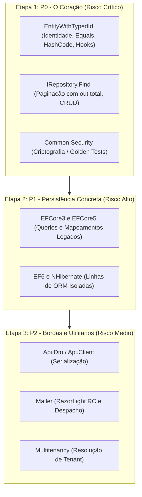

# Estratégia de Testes e Caracterização — Softprime.Framework

> Documento de apoio ao [Plano de Modernização](modernization-plan.md) · **Entregável da Issue [#7]** (Fase 0 — Conhecer e proteger).
>
> Data de elaboração: 2026-11-03 · Branch: `issue/7-estrategia-projetos-testes` · Base: `issue/10-inventario-consumidores-dependencias`

---

## 1. Contexto e Objetivo

A auditoria factual confirmou que a solution `src/Softprime.Framework.All.sln` **não possui nenhum projeto de teste automatizado** (nenhum `.csproj` referencia bibliotecas de teste). Sem uma rede de proteção, qualquer migração de target (.NET 10) ou atualização de dependências acarreta alto risco de regressão silenciosa em produção.

O objetivo deste documento é **definir a estratégia completa de testes de caracterização** que fixará o comportamento atual antes de qualquer alteração de código ou migração de infraestrutura.

> [!IMPORTANT]
> **Natureza de Planejamento (Fase 0):** Este documento estabelece a especificação técnica e a ordem de prioridades. Em estrita conformidade com os critérios de aceite da Fase 0, **nenhum código de teste, arquivo `.csproj` ou alteração na solution é implementado nesta rodada**, e **nenhuma cobertura de testes é declarada atingida**. A criação efetiva dos projetos ocorrerá no início da modernização.

---

## 2. Frameworks e Ferramentas Escolhidos

A suíte de testes do `Softprime.Framework` será padronizada com a seguinte stack:

| Papel | Ferramenta Escolhida | Justificativa Técnica |
|---|---|---|
| **Test Runner** | `xUnit` | Padrão consolidado no ecossistema .NET moderno, amplamente suportado por `dotnet test`, runners de CI/CD e Visual Studio. Suporta execução paralela nativa e multi-targeting (`net48;net10.0`). |
| **Asserções** | `FluentAssertions` | Sintaxe altamente expressiva e legível (`actual.Should().Be(expected)`), que produz relatórios detalhados com diff estruturado de grafos de objetos complexos em caso de falha. |
| **Mocking / Fakes** | `Moq` (4.x estável) | Padrão clássico no ecossistema .NET corporativo, ideal para isolar contratos de interfaces fundamentais (ex.: `IRepository<T>`, `IUnitOfWork`, dispatchers de e-mail). |
| **Persistência de Testes** | `SQLite` (em memória / local) | Permite caracterizar queries relacionais reais e transações dos ORMs sem exigir servidores SQL Server instalados na máquina do desenvolvedor ou no pipeline de CI. |

---

## 3. Estrutura e Organização dos Projetos de Teste

Para evitar inflar a solution com dezenas de projetos de teste (espelhamento 1:1 dos 14 projetos), adota-se uma **abordagem enxuta organizada por camada e responsabilidade**:

```text
Softprime.Framework/
├── src/
│   └── (14 bibliotecas de produção)
└── tests/
    ├── Softprime.Framework.Core.Tests/       # Testes de Domínio, Utilitários e DTOs
    ├── Softprime.Framework.Data.Tests/       # Testes de DAL e Adaptadores de Persistência
    ├── Softprime.Framework.SmokeTests.Net48/ # Aplicação console consumidora em .NET Framework 4.8
    └── Softprime.Framework.SmokeTests.Net10/ # Aplicação console consumidora em .NET 10
```

### Detalhamento dos Projetos:

1. **`tests/Softprime.Framework.Core.Tests`**
   - **Targets:** `net48;net10.0`
   - **Escopo:** Cobre a lógica de negócio e utilitários fundamentais:
     - `Softprime.Framework.Domain`
     - `Softprime.Framework.Common`
     - `Softprime.Framework.Api.Dto`
2. **`tests/Softprime.Framework.Data.Tests`**
   - **Targets:** `net48;net10.0`
   - **Escopo:** Cobre o contrato base de acesso a dados e os adaptadores de persistência:
     - `Softprime.Framework.DAL`
     - Caracterização de integração com `EFCore3`, `EFCore5`, `EF6` e `NH`
3. **Smoke Tests de Consumo por Target (`SmokeTests.Net48` e `SmokeTests.Net10`)**
   - **Escopo:** Projetos consumidores autônomos que simulam aplicações reais puxando os pacotes NuGet empacotados (`.nupkg`), validando o ciclo de vida de empacotamento, binding redirects e execução em cada runtime.

---

## 4. Matriz de Targets dos Testes

Os projetos de biblioteca do Framework miram `netstandard2.0`, `netstandard2.1` e `net48`. Como projetos de teste exigem um runtime executável, a suíte de testes será configurada como **Multi-Target**:

```xml
<TargetFrameworks>net48;net10.0</TargetFrameworks>
```

### O que essa matriz garante:
- **Execução em `net48`:** Roda no runtime clássico do Windows (.NET Framework CLR 4.0). Garante que nenhuma dependência ou comportamento quebre as aplicações corporativas legadas em produção.
- **Execução em `net10.0`:** Roda no runtime moderno (CoreCLR .NET 10 LTS). Garante que a evolução da plataforma seja compatível e pronta para novas aplicações.
- Ao executar `dotnet test`, o runner compila e executa toda a bateria de testes **duas vezes**, isolando regressões por runtime.

---

## 5. Priorização dos Comportamentos Críticos a Caracterizar

A caracterização do comportamento atual pré-migração será dividida em **3 etapas consecutivas de prioridade de risco**:



### 🔴 Etapa 1: Prioridade Máxima (P0 — Risco Crítico de Integridade)

Deve ser caracterizada antes de qualquer outra frente de trabalho:

#### 1. `EntityWithTypedId<TId>` (`Softprime.Framework.Domain`)
- **`IsTransient()`:**
  - Garantir que retorne `true` quando `Id` for `null`, `0` ou `Guid.Empty`.
  - Garantir que retorne `false` assim que um identificador válido for atribuído.
- **`Equals(object)` e operadores `==` / `!=`:**
  - Comparação por referência (`ReferenceEquals`).
  - Comparação de entidades transientes (duas instâncias não salvas com `Id == 0` nunca devem ser consideradas iguais entre si).
  - Comparação de entidades persistidas (mesmo tipo e mesmo `Id`).
  - Comparação envolvendo subclasses e proxies de ORM (ex.: proxies gerados pelo NHibernate ou Castle).
  - Comparação baseada em assinatura de domínio (`DomainSignatureAttribute`).
- **`GetHashCode()`:**
  - Validar que o hashcode calculado utiliza o multiplicador primo `31` e os atributos de assinatura de domínio.
  - **Invariante crítica:** Garantir que o valor retornado seja estável em memória após a primeira chamada (`_cachedHashcode`), evitando perda de chaves em `HashSet<T>` e `Dictionary<TKey, TValue>` quando a entidade for persistida.
- **Ciclo de Vida:**
  - Garantir a ordem de chamada e assinatura dos hooks virtuais: `BeforeSave()`, `AfterSave()`, `BeforeDelete()` e `AfterDelete()`.

#### 2. `IRepository<T>` (`Softprime.Framework.DAL`)
- **Paginação com parâmetro `out total`:**
  - Assinatura: `Find(Expression<Func<T, bool>> filter, out int total, int index = 0, int size = 50)`
  - Caracterizar indexação: confirmar se o índice de página é 0-based ou 1-based no comportamento atual.
  - Caracterizar cálculo do `total`: garantir que a contagem total de registros do predicado seja computada integralmente, independentemente de `size` e `index`.
  - Caracterizar comportamento quando o índice da página ultrapassa o número de registros existentes.
- **Contratos fundamentais de CRUD:**
  - `Get(key)` vs `Load(key)` (busca imediata vs proxy lazy).
  - Semântica de `Save(entity)`, `SaveOrUpdate(entity)`, `Update(entity)` e `Merge(entity)`.
  - Operações assíncronas correspondentes (`GetAsync`, `SaveAsync`, etc.).

#### 3. `Common.Security` (`Softprime.Framework.Common`)
- **Golden Tests de Criptografia / Hashing:**
  - Capturar pares conhecidos de entrada e saída (texto plano → texto cifrado / hash) gerados pelo código atual.
  - **Objetivo inegociável:** Garantir que qualquer refatoração de algoritmos legados (ex.: MD5, TripleDES, AES legado) continue decodificando com precisão os dados históricos e senhas já gravados nos bancos de dados de produção.

---

### 🟡 Etapa 2: Persistência Concreta e ORMs (P1 — Risco Alto)

- Caracterizar implementações concretas dos repositórios sobre `EFCore3`, `EFCore5`, `EF6` e `NH`.
- Validar se mapeamentos e queries compilam e executam com fidelidade semântica.
- Manter o isolamento das linhas legadas (`EF6` e `NH` têm ciclos de vida independentes e não devem ser fundidos com EF Core).

---

### 🟢 Etapa 3: Bordas, APIs e Mensageria (P2 — Risco Médio)

- **`Api.Dto` e `Api.Client`:** Caracterizar serialização/deserialização com `Newtonsoft.Json 12.0.3` para garantir que campos opcionais, nulos e enums não quebrem comunicação com APIs clientes.
- **`Mailer`:** Caracterizar renderização de templates com `RazorLight 2.0.0-rc.3` e isolar o contrato de envio das implementações `Mailer.AWS` e `Mailer.SendGrid`.
- **`Multitenancy`:** Caracterizar resolução de tenant a partir de cabeçalhos/requests e isolamento de cache em memória.

---

## 6. Smoke Tests de Consumo (NuGet)

Testar apenas via `ProjectReference` dentro da solution não garante que os consumidores externos consigam rodar os pacotes.

### Estratégia de Smoke Test planejada:
1. **Passo 1 (Pack local):** Compilar a solution e gerar os pacotes `.nupkg` em uma pasta local temporária (`build/artifacts/packages`).
2. **Passo 2 (Consumo isolado):** Executar os projetos `SmokeTests.Net48` e `SmokeTests.Net10` apontando para essa pasta local como feed NuGet privado.
3. **Passo 3 (Verificação de sanidade):**
   - Instanciação de entidades de domínio em `net48` e `net10.0`.
   - Chamada a métodos de extensão de `Common`.
   - Verificação de ausência de exceções de tipo `FileNotFoundException`, `TypeLoadException` ou conflitos de versão de assemblies do ecossistema ASP.NET Core e Newtonsoft.

---

## 7. Critérios de Aceite e Rastreabilidade

- [x] Estratégia de testes documentada com escopo, frameworks (`xUnit`, `FluentAssertions`, `Moq`), estrutura enxuta de projetos e matriz de targets (`net48;net10.0`).
- [x] Comportamentos críticos ordenados por prioridade (`EntityWithTypedId`, `IRepository`, `Common.Security`).
- [x] Smoke tests de consumo por runtime planejados.
- [x] **Não há declaração de cobertura atingida** (implementação reservada para a fase de desenvolvimento).
- [x] **Nenhum arquivo `.sln` ou `.csproj` foi modificado** na presente fase de planejamento.

---

<!-- Links -->
[#7]: https://github.com/softprime/Softprime.Framework/issues/7
[#10]: https://github.com/softprime/Softprime.Framework/issues/10
